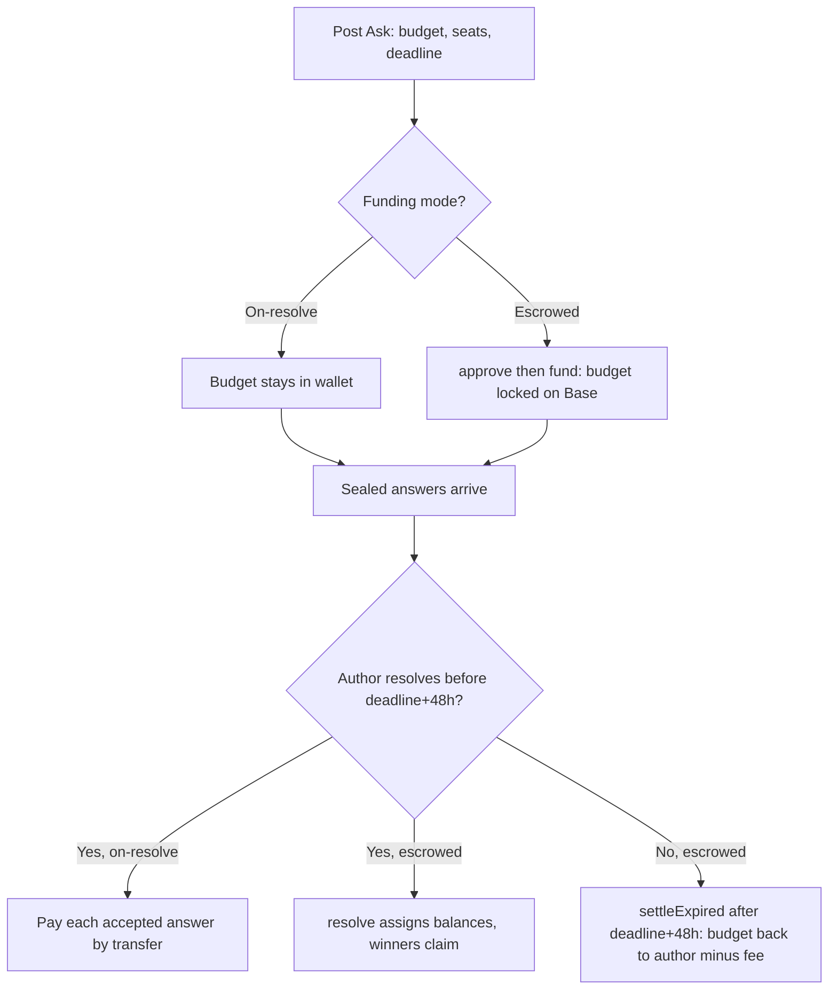

# Asks & escrow

An Ask is a question with a budget, a number of seats and a deadline. People answer, their answers stay sealed, and the author pays for the ones they accept.

## What it does

You post a question, say how much you're paying (the budget), how many answers you'll take (seats), and when it closes (deadline). It shows up in the feed as a card that counts down. Anyone can answer, but the answers stay sealed. You see how many arrived, never what they say, until you resolve. The per-answer price is the budget split evenly across seats, rounded down to the cent so payouts never exceed what you announced.

There are two funding modes, chosen per Ask and shown on every card:

- On-resolve is the default. Nothing is locked. When you accept an answer, you pay that person from your own wallet on Base. The budget is a promise, not a deposit.
- Escrowed pulls the whole budget up front into an escrow contract on Base that has no owner, no pause and no rescue function. Answerers can check on-chain that the money for their seat is really there before they write.

Because sealed work happens before payment, every card also shows the author's public resolve rate, how many of their past Asks they actually settled.

## How to use it

1. Go to [/asks](/asks), connect your wallet, and choose Ask something.
2. Set the question, budget, seats and a deadline (6h, 24h, 3d or 7d). Minimum $0.50 per answer, up to 20 seats.
3. Pick a funding mode. Escrow needs your wallet on Base and runs two prompts: approve the exact budget, then fund to lock it. On-resolve writes the Ask with no on-chain step.
4. Others answer sealed. One answer per wallet, up to 5,000 characters, and never on your own Ask. You (the author) sign in, open the answers, and pick winners.
5. Resolve. On-resolve pays each accepted answer by transfer. Escrow closes all seats in one `resolve` transaction that assigns balances; before the deadline that transaction must fill every seat, after the deadline you can award fewer.
6. Collect. Escrow payouts and any returned budget wait in the contract until the recipient claims them from [the Money tab](/asks?tab=money). There's no deadline to collect.

## How it flows

## The math

Per-answer price, split down to the cent:

$$\text{perAnswer} = \frac{\lfloor (\text{budget} / \text{seats}) \times 100 \rfloor}{100}$$

For escrowed Asks a fee applies only to budget that returns to the author: unused seats at resolve, or the whole budget if the Ask expires unresolved. Accepted answers are paid in full, untouched by the fee. The current fee is 250 bps (2.5%):

$$\text{fee} = \left\lfloor \frac{\text{returned} \times \text{bps}}{10000} \right\rfloor, \qquad \text{toAuthor} = \text{returned} - \text{fee}$$

An unresolved escrow can only be swept back 48 hours after the deadline (`settleExpired`). That window exists so the author has time to read the answers before anyone can reclaim. The button for sending an expired budget back sits on [the Money tab](/asks?tab=money), in the Locked section.

## Check it onchain

Escrowed Asks are fully verifiable on Base. The contract is deployed at [`0xD5f65Cfbe6A1AA1B6f82CBE0A336DDFCD39a5340`](https://basescan.org/address/0xD5f65Cfbe6A1AA1B6f82CBE0A336DDFCD39a5340) (settling in USDC; a matching deployment also runs on Base Sepolia for testing). Every escrow card links its fund transaction ("Check the deposit"). On BaseScan you can read the on-chain events: `AskFunded` when the budget locks, `SeatAwarded` per paid answer at resolve, `AskResolved` at close, and `Claimed` when money leaves the contract.

On-resolve Asks are not escrowed. Nothing is locked, so there's no contract balance to inspect. Each accepted answer instead carries its own payout transaction hash, viewable on [basescan.org](https://basescan.org). The sealing of answers and the resolve rate are enforced off-chain by the app's server, not by the contract.
