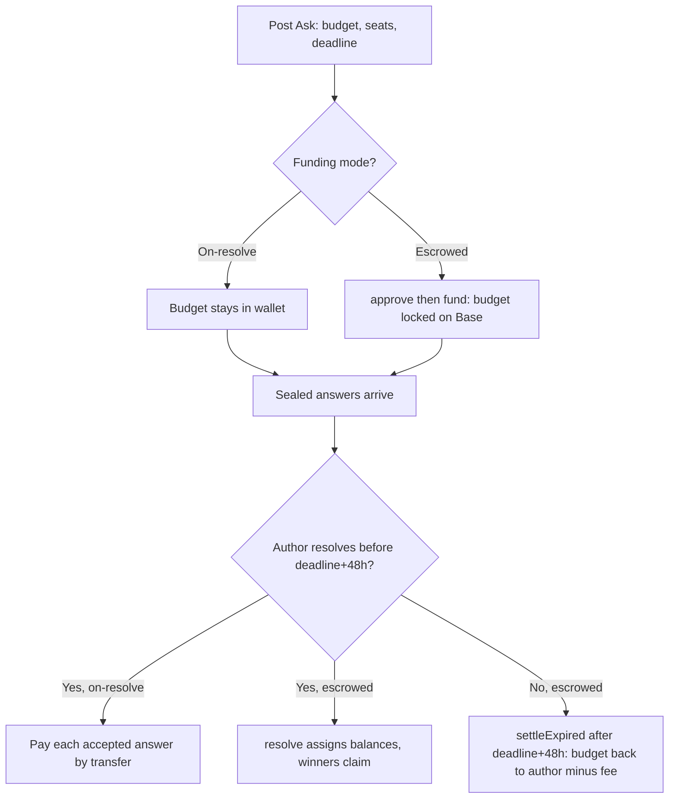

# Asks & escrow

An Ask is a question with a budget, a number of seats and a deadline. People answer, their answers stay sealed from each other, and the author pays for the ones they accept.

## What it does

You post a question, say how much you're paying (the budget), how many answers you'll take (seats), and when it closes (deadline). It shows up in the feed as a card that counts down. Anyone can answer, but the answers stay sealed: other answerers cannot read each other's work until the Ask is resolved, and everyone else sees only how many arrived. You, the author, read them as they come in. The per-answer price is the budget split evenly across seats, rounded down to the cent (to the lamport for SOL) so payouts never exceed what you announced.

There are three ways to fund an Ask, chosen per Ask and shown on every card:

- Escrowed pulls the whole budget up front into an escrow contract on Base that has no owner, no pause and no rescue function. Answerers can check on-chain that the money for their seat is really there before they write. It is preselected in the composer whenever your wallet is on Base.
- On-resolve ("Pay as you accept") locks nothing. When you accept an answer, you pay that person from your own wallet on Base. The budget is a promise, not a deposit.
- SOL on Solana also locks nothing: you pay each accepted answer in SOL from a Solana wallet linked to your account. See "Asks paid in SOL" below.

Because sealed work happens before payment, every card also shows the author's public resolve rate, how many of their past Asks they actually settled.

## How to use it

1. Go to [/asks](/asks), connect your wallet, and press Ask.
2. Set the question (up to 500 characters), budget, seats and a deadline (6h, 24h, 3d or 7d). Minimum $0.50 per answer in USDC, up to 20 seats.
3. Pick a funding mode. Either way, if you are not signed in yet, your wallet first asks for a free sign-in signature (no transaction, no gas); the server writes the Ask for the signed-in wallet. Escrow then needs your wallet on Base and runs two prompts: approve the exact budget, then fund to lock it. On-resolve writes the Ask with no on-chain step.
4. Others answer sealed. One answer per wallet, up to 5,000 characters, and never on your own Ask. You (the author) sign in, open the answers, and pick winners.
5. Resolve. On-resolve and SOL Asks pay each accepted answer by transfer, and paying the last seat closes the Ask by itself and unseals every answer. Escrow closes all seats in one `resolve` transaction that assigns balances; before the deadline that transaction must fill every seat, after the deadline you can award fewer.
6. Collect. Escrow payouts and any returned budget wait in the contract until the recipient claims them from [the Money tab](/asks?tab=money). There's no deadline to collect.

## Asks paid in SOL

The composer has a "Pay in" switch: USDC on Base, or SOL on Solana. A SOL Ask has no escrow; nothing is locked, and you pay each accepted answer from a Solana wallet you link to your account.

- The minimum is 0.005 SOL per answer and the budget is capped at 1,000 SOL. The per-answer amount is rounded down to the lamport.
- Linking a Solana wallet is one free signature of a message: it moves no funds, and the signature has to be fresh (ten minutes). One Solana wallet per account.
- Whoever answers can write before linking a wallet, but the payment has nowhere to go until they do. Their payout address is frozen when they answer.
- Paying an answer is one Solana transfer from your wallet to theirs, with the memo `mysphere:ask|v1|<askId>|<answerId>`. The server reads it back from Solana before it records the acceptance: it checks the payer, the recipient, the amount, that the transaction is not older than the answer, and that the signature was not used before.
- The cluster (mainnet or devnet) is fixed on the Ask when it is created, and the card shows a devnet badge on devnet.

This is the newest way to run an Ask, so read the payout signature on [explorer.solana.com](https://explorer.solana.com) rather than taking the card's word for it.

## How it flows

## The math

Per-answer price, split down to the cent:

$$\text{perAnswer} = \frac{\lfloor (\text{budget} / \text{seats}) \times 100 \rfloor}{100}$$

For escrowed Asks a fee applies only to budget that returns to the author: unused seats at resolve, or the whole budget if the Ask expires unresolved. Accepted answers are paid in full, untouched by the fee. The current fee is 250 bps (2.5%):

$$\text{fee} = \left\lfloor \frac{\text{returned} \times \text{bps}}{10000} \right\rfloor, \qquad \text{toAuthor} = \text{returned} - \text{fee}$$

An unresolved escrow can only be swept back 48 hours after the deadline (`settleExpired`). That window exists so the author has time to read the answers before anyone can reclaim. The button for sending an expired budget back sits on [the Money tab](/asks?tab=money), in the Locked section.

## Check it onchain

Escrowed Asks are fully verifiable on Base. The contract is deployed at [`0xD5f65Cfbe6A1AA1B6f82CBE0A336DDFCD39a5340`](https://basescan.org/address/0xD5f65Cfbe6A1AA1B6f82CBE0A336DDFCD39a5340) (settling in USDC; a matching deployment also runs on Base Sepolia for testing). Every escrow card links its fund transaction ("Check the deposit"). On BaseScan you can read the on-chain events: `AskFunded` when the budget locks, `SeatAwarded` per paid answer at resolve, `AskResolved` at close, `AskExpired` when an unresolved Ask is swept back, and `Claimed` when money leaves the contract.

On-resolve Asks are not escrowed. Nothing is locked, so there's no contract balance to inspect. Each accepted answer instead carries its own payout transaction hash, viewable on [basescan.org](https://basescan.org), or a Solana signature on [explorer.solana.com](https://explorer.solana.com) for a SOL Ask. The sealing of answers and the resolve rate are enforced off-chain by the app's server, not by the contract; the server signs the records it keeps (status, acceptances, payout addresses), so a browser cannot forge them.
