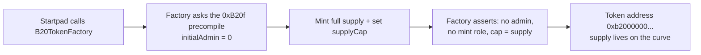

# B20 tokens

A **B20 token** is Base's network-native, ERC-20-compatible token standard. It is created by a factory built into the Base node itself, and it is born with **no admin** — nobody can mint more, pause transfers, or seize balances. Every token launched on Startpad is a B20.

> This page lives at `/b20`. It's reachable by link but currently hidden from the top navigation.

## What it does

A regular ERC-20 usually ships with an owner who can mint, pause, blacklist, or upgrade. B20 removes that whole category of trust. The Base network exposes a **factory precompile** at `0xB20f000000000000000000000000000000000000` — the same address on Base mainnet and Base Sepolia. It builds tokens deterministically and enforces their rules in the node software, not in per-token bytecode you have to audit.

Startpad uses the **ASSET** variant (there's also a STABLECOIN variant with a seize role — we don't use it). When Startpad creates a token it passes `initialAdmin = address(0)`, so the token has no administrator **from its first second**. In the same bootstrap window it mints the full supply and sets `supplyCap == totalSupply`. After that, minting more is impossible: there is no mint role held by anyone, and the cap already equals the supply. Our `B20TokenFactory` verifies all of this on-chain after creation — no live admin, mint, or pause role on anyone — and reverts the launch if any check fails.

Why admin-less matters on Startpad: the **entire token supply** is minted straight to the bonding curve. Because no key can dilute it, "1,000,000,000 total, 80% on the curve, 20% to the pool at graduation" is a fact the contract can't betray later.

## The self-describing address

A B20 address isn't random — it *encodes what it is*. Twenty bytes, laid out as:

| Bytes | Meaning |
| --- | --- |
| 0–9 (10 bytes) | fixed prefix `0xB2000000000000000000` |
| 10 (1 byte) | variant: `0x00` = ASSET, `0x01` = STABLECOIN |
| 11–19 (9 bytes) | `keccak256(deployer, salt)`, first 9 bytes |

So any address starting `0xb200000000000000000000…` is recognizably a B20 asset at a glance. Only the **last 9 bytes** (18 hex characters) vary, and they depend solely on the deployer and a `salt` the creator picks.

## How it flows

## The math — vanity addresses

Because the tail is `keccak256(deployer, salt)` and the creator chooses the salt, you can **mine** for a memorable ending by trying salts until the tail spells a hex-legal word. Only hex characters exist, so `o`, `l`, `i` become `0`, `1`; "cool" is unreachable. The expected number of tries for an $n$-character pattern is

$$E[\text{attempts}] = 16^{n}$$

— roughly a second at 4 characters, hours at 8. All of it runs locally in your browser (no network calls); the chain only learns the result when the token deploys.

## Check it onchain

- **Confirm it's a B20:** the token address begins `0xb2000000000000000000` and the 11th byte is `00` (ASSET). Look it up on [BaseScan](https://basescan.org).
- **Confirm admin-less:** on the token contract, `supplyCap()` should equal `totalSupply()`, and `hasRole(0x00…, anyone)` should be false. The factory already asserts this at launch and reverts otherwise.
- **The factory precompile** at `0xB20f000000000000000000000000000000000000` returns empty `eth_getCode` — it lives in the node, not as EVM bytecode. That's expected, not a sign it's missing.

Startpad's contract addresses and deploy block are in `docs/LAUNCHPAD-STAN.md`.
