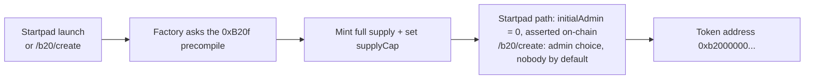

# B20 tokens

A B20 token is Base's network-native, ERC-20-compatible token standard. A factory built into the Base node creates it, and it can be born with no admin: nobody able to mint more, pause transfers, or seize balances. Every token launched on Startpad is a B20, and the `/b20` pages let you browse every B20 on Base, create one yourself, and mine a vanity address for it.

## What it does

A regular ERC-20 usually ships with an owner who can mint, pause, blacklist, or upgrade. B20 removes that whole category of trust. The Base network exposes a factory precompile at `0xB20f000000000000000000000000000000000000`, the same address on Base mainnet and Base Sepolia. It builds tokens deterministically and enforces their rules in the node software, not in per-token bytecode you have to audit.

Startpad uses the ASSET variant (there's also a STABLECOIN variant with a seize role that we don't use). When Startpad creates a token it passes `initialAdmin = address(0)`, so the token has no administrator from its first second. In the same bootstrap window it mints the full supply and sets `supplyCap == totalSupply`. After that, minting more is impossible: there is no mint role held by anyone, and the cap already equals the supply. Our `B20TokenFactory` verifies all of this on-chain after creation (no live admin, mint, or pause role on anyone) and reverts the launch if any check fails.

Here's why admin-less matters on Startpad. The entire token supply is minted straight to the bonding curve. Because no key can dilute it, "1,000,000,000 total, 80% on the curve, 20% to the pool at graduation" is a fact the contract can't betray later.

## The pages

- The market at [/b20](/b20) lists every B20 token created on Base, not just Startpad launches. You can search by name, ticker, or pasted address, switch between Traded, Never traded, No pool, and Everything, and sort traded tokens by 24h volume, biggest move, or newest. A side panel ranks the top tokens by volume.
- Each token page at `/b20/<address>` shows the price, a chart when a market exists, 24h volume, liquidity, FDV, and a supply panel that compares `totalSupply` to `supplyCap` and says in plain words whether more can ever be minted. If a Uniswap pool exists you get a Buy link; if not, the page says "No market yet" and links to opening a position.
- The create screen at `/b20/create` makes a B20 straight against the network factory: name, ticker, a fixed 1,000,000,000 supply, and an admin choice where "nobody" is the default (you can keep admin, and the token page will say so). You see the predicted address live and can mine a vanity ending in your browser before you sign. A fresh token has no pool, so nobody can buy it until someone opens one; the page says exactly that.
- The tools console at `/b20/tools` holds a standalone vanity address miner and a MemoPay memo builder that turns payer, recipient, amount, invoice, and salt into a 32-byte commitment.

## The self-describing address

A B20 address isn't random. It encodes what it is. Twenty bytes, laid out as:

| Bytes | Meaning |
| --- | --- |
| 0-9 (10 bytes) | fixed prefix `0xB2000000000000000000` |
| 10 (1 byte) | variant: `0x00` = ASSET, `0x01` = STABLECOIN |
| 11-19 (9 bytes) | `keccak256(deployer, salt)`, first 9 bytes |

So any address starting `0xb200000000000000000000…` is recognizably a B20 asset at a glance. Only the last 9 bytes (18 hex characters) vary, and they depend solely on the deployer and a `salt` the creator picks.

## How it flows

## The math behind vanity addresses

Because the tail is `keccak256(deployer, salt)` and the creator chooses the salt, you can mine for a memorable ending by trying salts until the tail spells a hex-legal word. Only hex characters exist, so `o`, `l`, `i` become `0`, `1`; "cool" is unreachable. The expected number of tries for an $n$-character pattern is

$$E[\text{attempts}] = 16^{n}$$

Roughly a second at 4 characters, hours at 8. All of it runs locally in your browser (no network calls); the chain only learns the result when the token deploys.

## Check it onchain

- To confirm it's a B20, check that the token address begins `0xb2000000000000000000` and that the 11th byte is `00` (ASSET). Look it up on [BaseScan](https://basescan.org).
- To confirm it's admin-less, check that `supplyCap()` equals `totalSupply()` on the token contract and that no admin role is held by anyone. Startpad's factory asserts this at launch and reverts otherwise; for tokens made on `/b20/create` the token page's supply panel states what the creator chose.
- The factory precompile at `0xB20f000000000000000000000000000000000000` returns empty `eth_getCode`. It lives in the node, not as EVM bytecode, so that's expected, not a sign it's missing.

Startpad's own contract addresses are listed on the [Startpad page](/Docs/startpad) of these docs.
