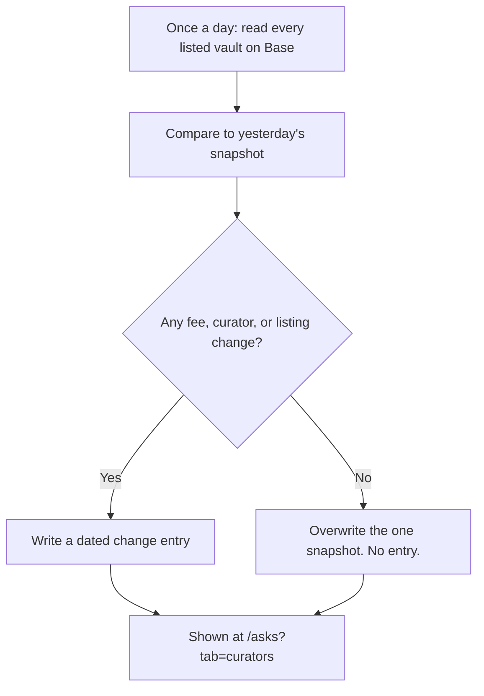

# Curator record

A dated, public record of what changes in the Morpho vaults listed on Base: the performance fee, who curates the vault, and whether the vault is still listed. It reads public Morpho data once a day and keeps only what changed.

## What it does

Every Morpho vault has a curator — the person or firm that sets the vault's fee and decides what it lends against. They can raise that fee, or hand the vault to someone else, and nobody has to tell you. The numbers are public, but no one writes down what they used to be, so "it was 5% last month" is a memory, not a fact.

This record fixes that. Once a day it reads the parameters of every **listed** vault on Base and keeps only the **differences**. Three things generate an entry:

- **Performance fee** changed (e.g. 5% → 15%)
- **Curator** changed (managed by A → managed by B)
- **Listing** changed (a vault entered or left Morpho's listed set)

It carries no opinions about any curator, no predictions, and nothing about anyone's wallet. It reads public vault parameters and nothing else.

The page is honest about its own state. Four situations that would otherwise look identical are shown differently:

| State | What you see |
|---|---|
| The read failed | "This record could not be read" — a failed read, *not* an empty record. We can't tell you whether anything changed. |
| Not started yet | No snapshot has ever been taken. The record hasn't started; an empty page is not evidence that nothing changed. |
| Watching, nothing changed | A **result**, with numbers: how many vaults, since when, how many checks — all with no change. |
| Entries exist | The list of dated changes. |

## How to use it

1. Open **[/asks?tab=curators](/asks?tab=curators)** — the record lives as a tab on the Asks page.
2. Read the header line: how many listed vaults are watched, since when, and when they were last checked.
3. Scan the cards. Each shows the vault, the kind of change (Fee / Curator / Listing), the change itself with a `→` arrow, who curated it, the dollars in the vault when it was seen, and the date range it was seen between.
4. If you need someone to actually read a specific vault for you, that's what an [Ask](/asks) is for: put a budget on the question and pay whoever answers.

## How it flows

The very first check only takes a baseline reading and produces **no entries** — a first reading is a starting point, not an event. Entries can appear only from the second check onward.

## The math

A fee is stored in basis points and shown as a percent. For a change from `fromBps` to `toBps`:

$$\text{percent} = \frac{\text{bps}}{100}, \qquad \Delta = \frac{\text{toBps} - \text{fromBps}}{100}\ \text{percentage points}$$

So 500 bps shows as 5%, and 500 → 1500 bps shows as 5% → 15% with a `+10 percentage points` delta. Note the delta is in *percentage points*, not a percent — a distinction the page keeps deliberately.

## Check it onchain

What the record shows is derived from **public Morpho data on Base** — the same vault parameters anyone can read. Fee and curator changes are onchain, so an exact block is provable; you can look up a vault and its curator on [app.morpho.org](https://app.morpho.org) or a block explorer like [BaseScan](https://basescan.org).

Be aware of the limits this page states about itself:

- **Dates are ranges, not moments.** It compares one daily reading to the previous one, so it knows a change happened *between two dates*, not the hour or block. It writes "seen between X and Y" rather than inventing a timestamp — it does **not** read the exact block from the chain today.
- **Collateral is not tracked.** A curator can also let a vault lend against something new, which changes your risk as much as a fee does. This page does not read that field and does not claim to watch it.
- **Yield and deposits are not tracked** — they move on their own every hour and aren't decisions.
- **Your wallet is never involved.** The record has no idea which vaults you use.

An empty page is never proof that a vault stayed the same — only that no fee, curator, or listing change was seen.
