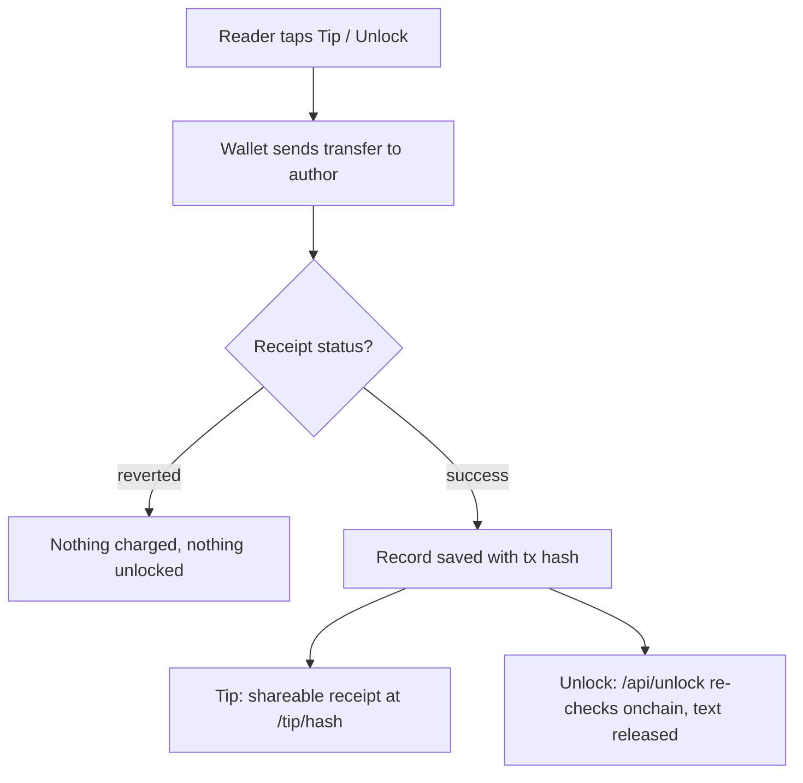

# Feed, posts & tips

The feed is the home timeline: you post, and the money moves onchain. You can tip any post in ETH, USDC and other native tokens across several networks, and an author can seal off part of a post behind a one-time payment (a paid unlock).

## What it does

A post is a normal entry in the timeline: text, an image or video, optional music, and a target network. Writing it doesn't cost gas. What settles onchain is the money attached to posts.

- Tips are direct wallet-to-wallet transfers. A native tip (ETH, CELO, CAMP) is a plain value transfer to the author's address; a token tip (USDC, WLD, LINEA) is an ERC-20 `transfer` straight to them. There is no MySphere contract in the middle and no platform cut, so the author receives the full amount and you pay only network gas.
- A paid unlock lets an author attach a premium part to a post with a set price. Readers see a blurred placeholder and a "Premium part of this post" button. Paying sends the amount directly to the author; only then is the hidden text released.

Tipping works on Base, Ethereum, Celo, World Chain, Linea, Robinhood Chain and Camp. Paid unlocks run on Base mainnet only (ETH or USDC).

## How to use it

1. Post. Open the composer, write, optionally attach media, pick the target network, and publish.
2. Tip a post. Tap Tip, choose a network and token, enter an amount (or a quick amount), and confirm in your wallet. On Base with USDC you can also pay with Base Pay. Once the transaction confirms, a shareable receipt is generated.
3. Sell part of a post. When composing, open the premium section, write the hidden text, and set a price in ETH or USDC.
4. Unlock someone's premium post. On Base, tap unlock. You sign in with your wallet first (no gas, no transaction), then pay the author. After the payment confirms, the text appears.

## How it flows

## Fees

There is no platform fee on tips or unlocks. The transfer goes wallet-to-wallet, so the author receives the full amount and you pay only the network's gas. A reverted transaction records nothing: no charge, no unlock. Amounts follow each token's own precision (USDC uses 6 decimals, ETH 18).

## Check it onchain

- Every confirmed tip is saved with its transaction hash and gets a receipt page at `/tip/<txHash>`, plus a link to the network's block explorer ([basescan.org](https://basescan.org), [etherscan.io](https://etherscan.io), and the others per network).
- For unlocks, the payment shows a View transaction link to `basescan.org/tx/<hash>`, and `/api/unlock` independently re-verifies the transaction before releasing the text.
- The posts themselves and the unlock/tip records live in the app's database, not onchain. What you can verify onchain is the payment. Smart-wallet and Base Pay payments return a userOp hash rather than a plain transaction hash, so the app resolves it where it can and otherwise links to the explorer's search. Not every legacy tip has a resolvable hash stored, so a few older receipts may not open a transaction page directly.
