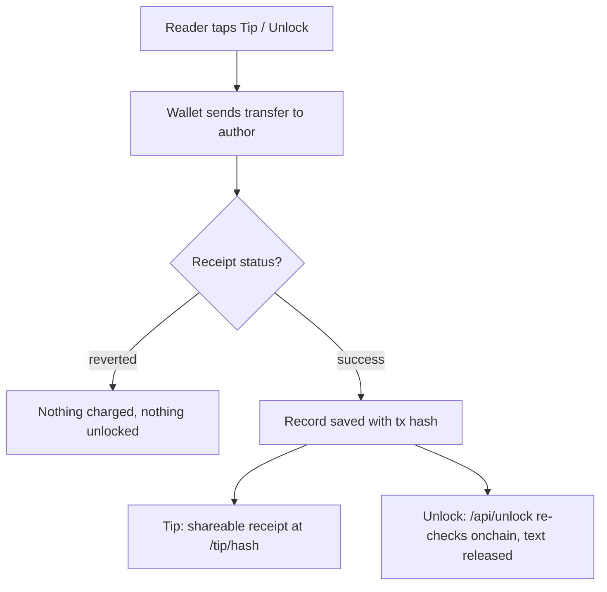

# Feed, posts & tips

The feed is the home timeline: you post, and the money moves onchain. Posts land on one of nine networks (eight EVM chains and Solana), readers tip authors wallet-to-wallet, an author can sell part of a post behind a one-time payment, support a creator monthly, or pin a post for a paid slot at the top.

## Posting

A post is text plus, if you want, an image or a video, a Spotify track, and hashtags or mentions. You pick the target network in the composer: Base, Camp, Linea, Celo, Ethereum, World Chain, Robinhood Chain, Arc (on Arc testnet), or Solana. Publishing signs a transaction on that network, so the post has an onchain anchor you can open in an explorer. On the EVM networks the transaction goes to that network's post contract; on Solana it is a memo, described below.

On Base the composer has two publish buttons:

- Post writes the post onchain through the post contract.
- PostCoin additionally mints the post as a Zora coin on Base. The first word of your post becomes the $ticker, and the feed card gets View on Zora and View on DexScreener links. If minting fails, the post still goes out as a plain post.

The music picker pulls from your own Spotify (recent, saved, albums, playlists) once you link it in your Builder Profile. If a post's text contains a B20 token address, the feed renders a live token card under it, with price, volume, and a Buy link when the token has a pool.

## Posting on Solana

Solana is the one network that is not EVM, so it needs a second wallet: Phantom, Solflare or Backpack, next to the EVM wallet you signed in with. Your EVM profile stays the author. The Solana wallet pays the network fee, about 0.000005 SOL, and signs a memo through Solana's Memo Program:

```
mysphere:post|v2|<post id>|<Solana address that signed>|<first 280 bytes of the post>
```

The memo holds the Solana address that signed, not your EVM address. It is public and permanent, and since the post shows under your EVM profile, anyone who looks can tie the two wallets together. Before sending, the app asks you to sign in with your EVM wallet if you have not (a signature, no gas), because our server saves Solana posts itself after reading the transaction back from Solana. The Solana tab is not there inside Farcaster mini apps, which offer an EVM wallet only.

A Solana post that names a token records the author's balance in it (Proof of Bags), and it can take tips in SOL and paid replies from a link. All three are explained on [Solana: bags, tips & replies](/Docs/solana).

## Tips

Tips are direct wallet-to-wallet transfers. A native tip (ETH, CELO, CAMP, and USDC on Arc, where USDC is the network's own unit) is a plain value transfer to the author's address; a token tip (USDC on Base, WLD, LINEA, USDG) is an ERC-20 `transfer` straight to them. There is no MySphere contract in the middle and no platform cut, so the author receives the full amount and you pay only network gas.

| Network | Tokens you can tip |
| --- | --- |
| Base | ETH, USDC (USDC also via Base Pay) |
| Ethereum | ETH |
| Celo | CELO |
| World Chain | ETH, WLD |
| Linea | ETH, LINEA |
| Robinhood Chain | ETH, USDG |
| Arc (testnet) | USDC |
| Camp | CAMP |

That is the eight EVM networks. Solana posts are tipped in SOL instead, from a link rather than the Tip button, and those tips are not recorded here: see [Solana: bags, tips & replies](/Docs/solana).

Tap Tip, choose a network and token, enter an amount or a quick amount, and confirm in your wallet; the app switches your wallet to the right chain first. Once the transaction confirms, a shareable receipt is generated at `/tip/<hash>`.

## Selling part of a post

A paid unlock lets an author seal part of a post behind a set price, in USDC or ETH on Base. Readers see a blurred placeholder and an unlock button with the price. Paying sends the amount directly to the author; the server re-checks the transaction onchain before releasing the text. You sign in with your wallet first (no gas, no transaction), and an author always sees their own content. The sealed text lives in a collection the browser is refused outright, so it is not in the page source waiting to be dug out.

## Supporting a creator

Every post's action bar has a support button with three tiers: Supporter at \$1, Insider at \$5, and Patron at \$25 per 30-day period, payable for 1, 3, or 6 periods. It is a one-off USDC payment on Base, not a subscription that renews by itself.

## Pinning a post

You can pin your own post to the slot above the feed for a paid, fixed duration:

| Duration | ETH | USDC via Base Pay |
| --- | --- | --- |
| 1 hour | 0.0005 | 0.625 |
| 6 hours | 0.002 | 2.50 |
| 24 hours | 0.005 | 6.25 |
| 7 days | 0.02 | 25.00 |

The ETH path pays a pin contract on Base; the Base Pay path settles in USDC at half the ETH price. A timer on the post shows how long the pin has left, and you can extend it.

## Asks in the feed

The composer's second pill switches from Post to Ask: the same form as on [/asks](/asks), with a budget, seats, a deadline, the USDC or SOL choice, and the escrow choice. Above the post list an Ask rail shows open and resolved Asks; you can answer straight from the rail, and authors are sent to /asks to resolve. The details live on the [Asks page](/Docs/asks) of these docs.

## Social

- Likes and comments sit on every post; a comment can be anchored onchain with the comment contract of the network your wallet is on, which is not necessarily the post's network. Under Solana posts anyone can also leave a paid reply: a reply plus at least 0.001 SOL to the author in one Solana transaction, marked "paid reply" with its amount.
- Follow lives on the author's avatar. Follows, Friends (people you both follow), and Discover are separate views in the left navigation, and the feed can be switched between All Posts, Follows, and Basenames. On the phone a compact picker also filters the list by network.
- Notifications collect likes, comments, mentions, follows, friend requests, pins, and tips, with a type filter and mark-all-read. SOL tips and paid replies under Solana posts send no notification: replies show under the post, and tips show only in the author's Solana wallet.
- Share opens the post's public page at `/post/<id>`; every post also links its transaction in the right explorer. For Solana posts that page also links the reply and tip pages, and in the feed a line under each Solana post offers Share on X and Copy link for its reply link.

## Profiles and points

Your Builder Profile gathers what your address has done: bio, social links, creator earnings from tips, follow stats, a referral dashboard, your Talent Protocol builder score, and, once you link them through Camp, your X and Spotify profiles. Wallets that hold a Zora creator coin get a buy and sell section for it.

Points are counted from activity: 5 per post, 1 per like received, a 25% activity bonus on top, and one-time bonuses for names (a Basename is worth 1000, `.sphere` 1500, `.camper` 1000, `.celo` 1250, `.world` 1250). The Trends panel ranks the most active users and shows the app-wide totals.

## How it flows



## Fees

There is no platform fee on tips or unlocks. The transfer goes wallet-to-wallet, so the author receives the full amount and you pay only the network's gas. A reverted transaction records nothing: no charge, no unlock. Amounts follow each token's own precision (USDC uses 6 decimals, except on Arc, where it is the network's own unit with 18; ETH uses 18). SOL tips and paid replies carry no platform fee either: the SOL goes straight to the post's Solana wallet. The paid pin is the one feed feature with a price list of its own, shown in the table above.

## Check it onchain

- Every confirmed in-app tip is saved with its transaction hash and gets a receipt page at `/tip/<txHash>`, plus a link to the network's block explorer ([basescan.org](https://basescan.org), [etherscan.io](https://etherscan.io), and the others per network). SOL tips from a link are not saved here; their Solana transaction is the only record.
- Solana posts and paid replies open on [explorer.solana.com](https://explorer.solana.com): the post's memo starts with `mysphere:post|v2|`, and each paid-reply badge links its own transaction.
- For unlocks, the payment shows a View transaction link on Base, and `/api/unlock` independently re-verifies the transaction before releasing the text.
- PostCoin posts carry their Zora coin address; the Zora and DexScreener links on the card open the same token the transaction created.
- The posts themselves and the unlock and tip records live in the app's database; what you verify onchain is the money and the post's anchor transaction. Smart-wallet and Base Pay payments return a userOp hash rather than a plain transaction hash, so the app links the explorer's search instead of a raw `/tx/` URL where needed.
