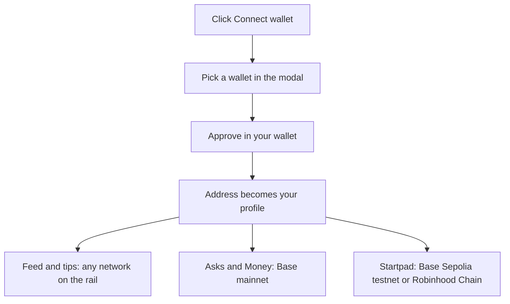

# Getting started

MySphere is an onchain social app on Base where the timeline is money. Everything runs from one wallet connection. The same wallet is your login, your identity, and the account that signs every post, tip, and trade. There is no email signup and no password.

## What it does

Connecting a wallet opens the whole app. Your address becomes your profile. Your name and avatar are resolved from onchain identity, and the wallet button in the header shows your Base balance once you are in.

MySphere spans several networks, and each part of the app lives where it belongs:

- Posting and tips work across many chains. The network rail at the top of the feed lets you switch between Base, Camp, Linea, Celo, Ethereum, World, and Robinhood Chain. You post and tip on whichever one you pick.
- Asks (a question with a budget held in escrow) and your Money ledger live on Base mainnet.
- Startpad, the B20 bonding-curve launchpad, runs on Base Sepolia (a testnet) and on Robinhood Chain. On Base Sepolia the tokens use the network's B20 standard; on Robinhood they are plain ERC-20s. Because Base Sepolia is a testnet, launching and trading there uses test ETH, not real money.

Not every route is switched on. During the current redefinition, several modules are turned off and redirect to the feed: `/base`, `/basemorning`, `/marketplace`, `/mycamp`, `/MyAgents`, `/MyClaw`, `/swap`, and `/yapscan`. The live surfaces are the feed (`/basechat`), Asks (`/asks`), Money (`/money`), Startpad (`/startpad`), and these docs (`/Docs`).

## How to use it

1. Open MySphere and click Connect wallet in the top-right.
2. Pick a wallet from the list. Options include Base Account (a smart wallet you create with a passkey, no extension needed), Coinbase Wallet, MetaMask, Gemini, Safe, WalletConnect (scan with your phone), or any browser wallet your device announces.
3. Approve the connection in your wallet. Once connected, the button becomes your avatar and name; click it for balance, block explorer, bridge, and disconnect.
4. To post or tip, open the feed and choose a network on the story rail at the top.
5. To trade tokens on Startpad, the launchpad switches its own network (Base Sepolia or Robinhood) and reloads so every read and write happens on the right chain.

## How it flows

## Check it onchain

Your connection itself is off-chain. Connecting a wallet signs nothing and costs nothing. What you can verify is everything you *do* after that. From the wallet menu, Base Scan opens your address on [basescan.org](https://basescan.org), where your Asks and Money activity on Base mainnet appear as transactions. Startpad activity is on its own explorers: Base Sepolia at [sepolia.basescan.org](https://sepolia.basescan.org) and Robinhood Chain at [robinhoodchain.blockscout.com](https://robinhoodchain.blockscout.com). Each module page links to the exact contract and event you can open. Start with the module you want and follow its "check it onchain" section from there.
