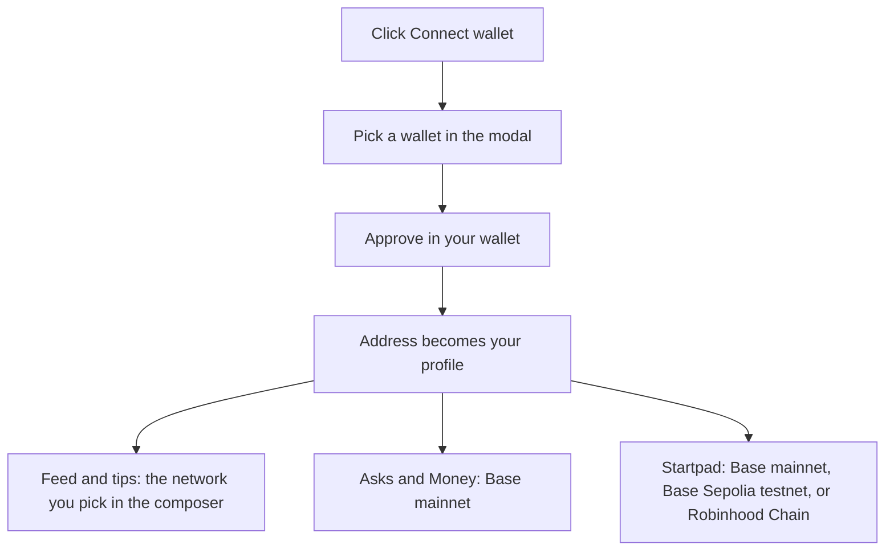

# Getting started

MySphere is an onchain social app on Base where the timeline is money. Everything runs from one wallet connection. The same wallet is your login, your identity, and the account that signs every post, tip, and trade. There is no email signup and no password.

## What it does

Connecting a wallet opens the whole app. Your address becomes your profile. Your name and avatar are resolved from onchain identity, and the wallet button in the header shows your Base balance once you are in.

MySphere spans several networks, and each part of the app lives where it belongs:

- Posting and tips work across many chains. You pick the network in the composer: Base, Camp, Linea, Celo, Ethereum, World Chain, or Robinhood Chain.
- Asks (a question with a budget held in escrow) and your Money ledger live on Base mainnet.
- Startpad, the bonding-curve launchpad, runs on Base mainnet with real ETH (the default network), on Base Sepolia (a testnet), and on Robinhood Chain.

## The live map

- [/basechat](/basechat) is the feed: posts on seven networks, tips, paid unlocks, creator support, paid pins, profiles, and the Ask composer.
- [/asks](/asks) holds open Asks, sealed answers, resolving, and the curator record tab.
- [/asks?tab=money](/asks?tab=money) is your own ledger; the Paid tab next to it is the public tape of settled tips.
- [/startpad](/startpad) is the token launchpad; each token has its own page with a chart and trade panel.
- [/b20](/b20) lists every B20 token on Base, and can create one straight against the network factory.
- [/how](/how) lists every action you can take today, each with its price and what you sign.
- [/how?tab=re-definition](/how?tab=re-definition) is the state of the product: what runs now and what is still being built.
- [/Docs](/Docs) is this documentation.

Invite links land on `/join`, and every post, profile, tip, and Ask has a public share page (`/post/<id>`, `/u/<address>`, `/tip/<hash>`, `/ask/<id>`).

## How to use it

1. Open MySphere and click Connect wallet in the top-right.
2. Pick a wallet from the list. Options include Base Account (a smart wallet you create with a passkey, no extension needed), Coinbase Wallet, MetaMask, Gemini, Safe, WalletConnect (scan with your phone), or any browser wallet your device announces.
3. Approve the connection in your wallet. Once connected, the button becomes your avatar and name; click it for balance, block explorer, bridge, and disconnect.
4. To post or tip, open the feed and pick a network in the composer.
5. To trade tokens on Startpad, the launchpad switches its own network (Base mainnet, Base Sepolia, or Robinhood) and reloads so every read and write happens on the right chain.

## How it flows

## Check it onchain

Your connection itself is off-chain. Connecting a wallet signs nothing and costs nothing. What you can verify is everything you do after that. From the wallet menu, Base Scan opens your address on [basescan.org](https://basescan.org), where your Asks and Money activity on Base mainnet appear as transactions. Startpad activity is on its own explorers: Base mainnet at [basescan.org](https://basescan.org), Base Sepolia at [sepolia.basescan.org](https://sepolia.basescan.org), and Robinhood Chain at [robinhoodchain.blockscout.com](https://robinhoodchain.blockscout.com). Each module page links to the exact contract and event you can open. Start with the module you want and follow its "check it onchain" section from there.
