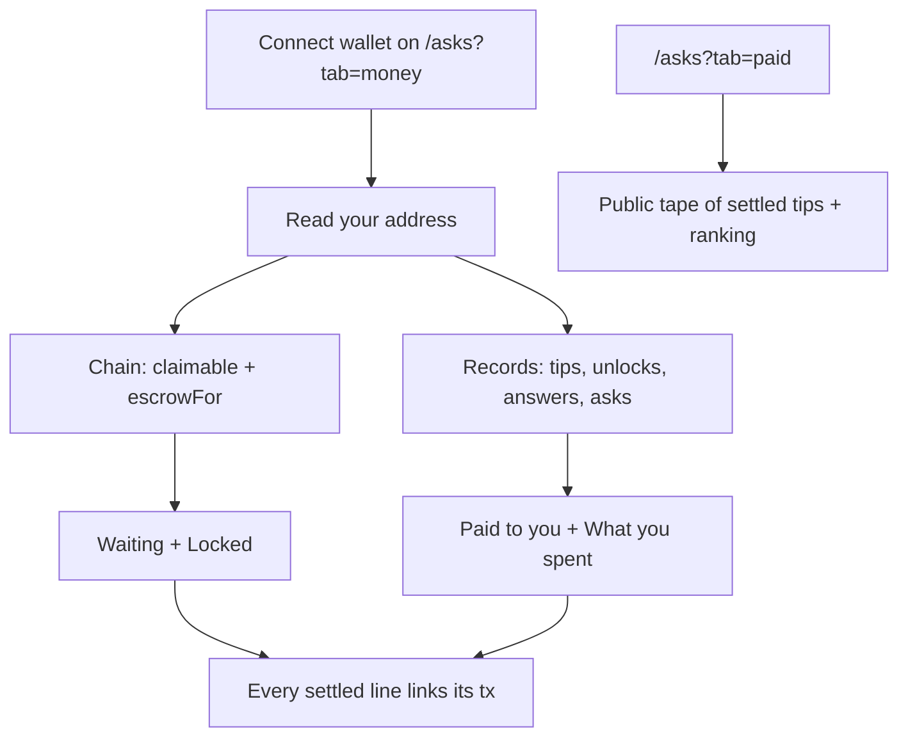

# Money & Paid

Two tabs, both about money that actually moved through MySphere, not a token-price portfolio. Money (`/asks?tab=money`) is your own ledger, built from your wallet address. Paid (`/asks?tab=paid`) is a public tape of tips that settled onchain.

## What it does

Your wallet already shows token balances and prices better than we could. This page does the thing your wallet can't: it reconstructs what happened inside this product, from your address alone.

The Money tab answers four questions, in this order:

1. Waiting for you is what the Ask escrow contract owes your address, read live from the chain (`claimable`). It's the only number here waiting on an action from you. The rest is history.
2. Locked in your open Asks covers your own escrowed Asks that nobody has closed: how much the contract is still holding, read per Ask via `escrowFor`. Once an Ask's deadline and its 48-hour grace window have both passed, a button lets you send the budget back to yourself.
3. Paid to you gathers tips received, posts others unlocked, and answers of yours that got accepted. Each settled line carries its transaction hash.
4. What you spent lists tips you sent, posts you unlocked, and budgets you locked in escrow.

Below those sections the page also states what your Asks without escrow owe for the answers you accepted. Those are paid straight from your wallet, so that line is a sum, not a list of hashes.

The Paid tab is public and shared. It shows a receipt-style tape of tips that settled onchain, plus a ranking of who has been paid most. The ranking covers the last 7 days when there is enough recent activity and falls back to all time otherwise; the header above it says which window you are looking at. The data behind the tab is cached for an hour.

## How to use it

1. Open `/asks?tab=money` and connect a wallet. The whole page is built from your address, and nothing is stored elsewhere.
2. Check Waiting for you at the top; if a balance is there, collect it (a signed transaction on Base).
3. Scan Locked, Paid to you, and What you spent. Click any line's hash to open the transaction in a block explorer.
4. If an escrowed Ask of yours expired unresolved, the Locked section shows a button that sends the budget back once the 48-hour window has passed. The refund lands as a contract balance, so collecting it is the Waiting for you step at the top.
5. Switch to Paid (`/asks?tab=paid`) to see the public tape and the ranking.

## How it flows

## The math

When an expired Ask's budget comes back to you, the split matches the contract exactly. The fee rounds down, and you get the remainder:

$$\text{fee} = \left\lfloor \frac{\text{budget} \times \text{feeBps}}{10{,}000} \right\rfloor, \qquad \text{toAuthor} = \text{budget} - \text{fee}$$

The refund lands as a balance in the contract, not in your wallet. Collecting it is the separate "Waiting for you" transaction at the top of the page. Amounts everywhere are summed per token and never added across tokens, because the page doesn't know exchange rates and won't pretend to.

## Check it onchain

Every settled line (each tip, unlock, accepted answer, escrow funding, and expiry refund) links its transaction hash to the block explorer of the network it settled on. Lines with no recorded hash are labelled as such rather than shown with a dead link, because an entry you can't verify shouldn't look like one you can.

What is not independently verifiable: the "Waiting" and "Locked" figures are live chain reads of the escrow contract (trustworthy but transient; they change as Asks resolve). Payouts from Asks without escrow are paid straight from the author's wallet, so their proof sits on each individual answer over on [/asks](/asks), not as a hash on this page. And the public Paid tape shows tips only; unlocks and Ask payouts appear in your own ledger, not on the shared tape.
