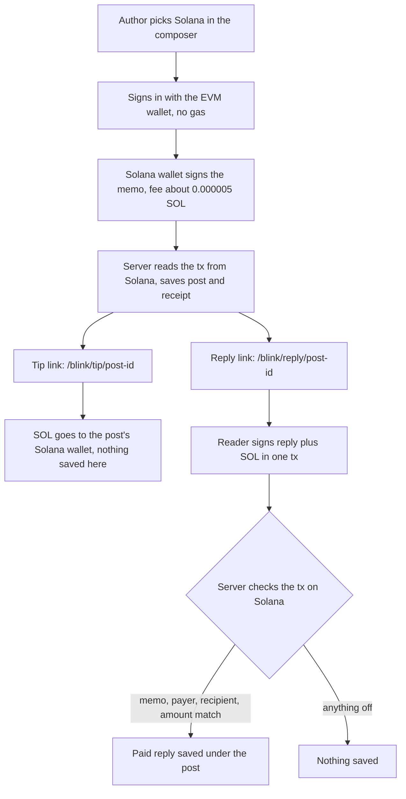

# Solana: bags, tips & replies

Solana is the ninth network in the composer and the only one that is not EVM. A post there works differently from the other eight: your EVM profile stays the author, a separate Solana wallet pays the fee and signs, and the receipt is a memo rather than a call to a MySphere contract. Three more things hang on that receipt: Proof of Bags, tips in SOL, and paid replies from a link.

All of it runs on Solana mainnet today. Two limits up front. No real post has carried Proof of Bags yet: it was checked by simulating transactions against mainnet. And nobody outside the team has paid a SOL tip or a paid reply on mainnet yet.

## Posting on Solana

1. In the feed composer, pick Solana. The tab is not there inside Farcaster mini apps, which give you an EVM wallet and nothing else.
2. The first click on the Solana button opens a Solana wallet picker: Phantom, Solflare, Backpack, or any wallet your browser announces through Wallet Standard.
3. Keep your EVM wallet connected. The post is saved under that profile, and if you have not signed in with it yet, the app asks you to before anything is sent. Signing in is a signature, not a transaction, and costs nothing. Decline it and nothing goes out.
4. Your Solana wallet signs one transaction and pays the network fee, about 0.000005 SOL. There is no MySphere program on Solana: the transaction writes a memo through Solana's own Memo Program.
5. Once the transaction confirms, our server reads it back from Solana and only then saves the post. It checks that the memo carries this post's id and this text, and that the wallet in the memo is the one that paid the fee. It takes the author from your signed session, not from the request. A transaction older than 30 minutes does not create a post.

The memo looks like this:

```
mysphere:post|v2|<post id>|<Solana address that signed>|<post text>
```

The text in it has runs of spaces and line breaks collapsed to single spaces and is cut at 280 bytes, with an ellipsis if it was longer. The full post, images, video and music live in MySphere's database, like posts from every other network.

What that makes public: the memo holds your Solana address, not your EVM sign-in address, so the chain on its own does not connect the two. MySphere does. The post shows under your EVM profile and its receipt link opens a transaction signed by your Solana wallet, so anyone who looks can tie the two wallets together. The memo is permanent. Editing or deleting the post here changes nothing on Solana.

A Solana post can be deleted only by its author or a MySphere admin, because paid replies hang under it.

## Proof of Bags

If a Solana post names a token, the same transaction records how much of that token your Solana wallet held at that moment. Anyone can read it in an explorer.

How a token gets named:

- Paste its mint address, bare or inside a pump.fun, Birdeye, Jupiter (jup.ag) or Solscan link.
- A DexScreener link counts only when its URL holds the token address. Many hold the trading pair's address instead, and a pair is not a token.
- Cashtags such as \$XYZ are not read. A ticker does not pick out one token, and copying tickers is a standard scam.

When the composer sees an address-shaped string, it shows a Proof of Bags note next to the Solana button. That note appears for any string of the right shape, including wallet and pair addresses. The real check happens when you post: the app asks Solana which of those strings are token mints (SPL Token or Token-2022) and drops the rest. Up to three tokens are recorded per post. If that check fails, the post goes out without the proof.

The mechanism: the transaction carries a second memo instruction (Memo Program v1, `mysphere:bags|v1|<mint>,<mint>`) that lists your wallet's standard token account for each token, read-only. Solana writes the balance of every token account listed in a transaction into that transaction's own record, so the balance at the moment of posting stays on the chain. Nothing moves and no balance changes.

Only the wallet's standard (associated) token account for that token counts. Tokens held in another token account, or in another wallet, are not seen.

Under the post, a line compares the recorded balance with what the same account holds now. "Now" is read from Solana when the line loads and can be a few minutes old, because the answer is cached.

| The line reads | What it means |
| --- | --- |
| Posted holding N \$XYZ · still holds all of it | The balance now equals the balance at posting |
| Posted holding N \$XYZ · wallet up P% since | The balance is higher now |
| Posted holding N \$XYZ · wallet down P% since | The balance is lower now, but not zero |
| Posted holding N \$XYZ · wallet now holds none | The balance is zero now |
| Posted with no \$XYZ · wallet holds N now | Zero at posting, some now |
| Posted with no \$XYZ in the wallet | Zero at posting and zero now |

The line says wallet, never sold. A drop can be a sale or a move to the author's own cold wallet, and the chain cannot tell them apart. The token's symbol comes from Jupiter; if that lookup fails, the line shows a shortened mint address. A post with no verified proof shows no line at all.

## Tips in SOL

Every Solana post can be tipped in SOL from a link:

```
https://mysphere.fun/blink/tip/<post id>
```

- The page offers 0.01, 0.05 or 0.25 SOL, or any amount from 0.001 SOL up to 100 SOL.
- The SOL goes to the Solana wallet that signed the post, as our server recorded it when the post was saved. It is not an address the author picked for payouts: if the author posted from a throwaway wallet, the tip lands there. The tip page does not print that address. To see it before you pay, open the post's receipt: the wallet that paid its fee is the one the tip goes to.
- One transaction: a SOL transfer straight to that wallet, plus a memo `mysphere:tip|<post id>`. No MySphere contract sits in the middle and nothing is taken. You pay the network fee.
- You cannot tip your own post from the wallet that signed it.

MySphere records nothing about a SOL tip. It is not in the tips collection, not on Paid, not in your Money ledger, not in the post's "in tips" total, it gets no `/tip/<hash>` receipt page, and it sends the author no notification. The Solana transaction is the whole record.

Nobody outside the team has sent a SOL tip on mainnet yet.

## Paid replies

A paid reply is a reply and a tip in one Solana transaction:

```
https://mysphere.fun/blink/reply/<post id>
```

- Write the reply and pick 0.001, 0.01 or 0.05 SOL. 0.001 SOL is the minimum.
- The transaction carries a memo `mysphere:reply|v1|<post id>|<your reply>` and a SOL transfer to the post's Solana wallet, the same wallet a tip goes to.
- The reply is limited to 280 bytes after spaces are collapsed. Longer text is refused, not cut, so nobody's paid words get trimmed. Emoji and letters outside basic Latin take more than one byte each; the page counts bytes as you type.
- Our server reads the transaction back from Solana before saving anything. It checks the memo, who paid, who received and how much, and it takes the reply text from the chain, not from the request. Only then does the reply appear under the post, marked "paid reply · X SOL" and linked to its transaction.
- You cannot send a paid reply from the wallet that signed the post.
- The replier shows as a shortened Solana address. There is no MySphere profile behind it.
- Paid replies exist only under Solana posts, because only there do we know a Solana wallet for the author.

The reply text is on Solana for good. Whoever sent it cannot edit or delete it. The post's author or a MySphere admin can remove it from MySphere, but the memo and the SOL stay where they are.

As with tips, the SOL is not on Paid or in Money, and the author gets no notification. The reply shows under the post.

Nobody outside the team has paid for a reply on mainnet yet.

## Where to get the links

- In the feed, every Solana post carries a line: "Paid replies on. Anyone can reply from X and tip in SOL (0.001 min)." Share on X opens a draft on X with the post's reply link, and Copy link copies it.
- The post's own page, `/post/<post id>`, links "Reply and tip the author" and "just tip" for Solana posts.

## How to reply from X

1. Find a MySphere reply link on X (`mysphere.fun/blink/reply/...`), or post one yourself with Share on X under a Solana post.
2. Today the link shows on X as a normal link preview for everyone, not as a card with a pay button. X draws that card only for sites listed in Dialect's Actions Registry, and mysphere.fun is not listed yet (checked 23 September 2026). Click the link.
3. Our reply page opens in your browser and shows the post. On a phone, the easiest route is to open the link inside your Solana wallet app's built-in browser.
4. Write the reply. The counter under the box shows bytes used out of 280.
5. Pick 0.001, 0.01 or 0.05 SOL and press the button. If no Solana wallet is connected, it reads "Connect a Solana wallet" first; once one is, it reads "Reply and tip" with the amount.
6. Approve the transaction in your wallet.
7. Wait while the page confirms on Solana and checks your payment. "Reply posted, and the author got X SOL" means the reply is under the post on MySphere with its paid-reply badge.
8. If the page says saving has not gone through yet, your reply is paid and on Solana. Retry from the same page. If you closed it, open the reply link again and use "Already paid? Paste your transaction signature". The server reads the reply and the tip from the chain and saves it once. This never charges you again.

## Turn on Blinks

Blinks are Solana Actions drawn as cards inside X, with the text box and the amount buttons in the post itself. A card needs three things:

- a desktop browser with the Phantom or Backpack extension,
- Blinks switched on in that extension (they are off by default),
- the site listed in Dialect's Actions Registry.

MySphere is not in the registry yet (checked 23 September 2026), so for our links nobody sees a card today, whatever their settings. Our reply and tip pages work without any of this.

To switch Blinks on:

1. Phantom browser extension: Settings, then Experimental Features, then turn on Solana Actions on X.
2. Backpack browser extension: Settings, then Preferences, then turn on Allow Solana Actions on X.
3. Reload x.com.

Wallets rename their menus between versions. If you cannot find the switch, look for "Actions" or "Blinks" in the wallet's settings.

## How it flows



## The math

A SOL is $10^9$ lamports, so the reply minimum of 0.001 SOL is exactly 1,000,000 lamports, and the server compares whole lamports, never fractions.

The Proof of Bags percentage compares the two balances of the same token account:

$$\text{change} = \frac{\text{now} - \text{at post}}{\text{at post}} \times 100\%$$

It is computed in integers on the raw token amounts, so a memecoin's huge supply loses no precision. It is kept to a hundredth of a percent, with anything smaller dropped, and shown with at most one decimal. It only applies when the wallet held something at posting. A balance that went from something to zero reads "wallet now holds none".

## Check it onchain

Everything below opens on [explorer.solana.com](https://explorer.solana.com). A Solana post's explorer link in the feed, and the "receipt" link next to "on solana" on its own page, open its transaction.

- Solana post: the transaction has a Memo Program v2 instruction starting `mysphere:post|v2|`, and the fee payer is the address written in the memo.
- Proof of Bags: the same transaction has a Memo Program v1 instruction `mysphere:bags|v1|` followed by the mints, and its Token Balances section shows the wallet's token account at posting. If the wallet held none, that row shows a zero balance, or there is no row at all because the account did not exist yet. Either one is the proof. The "proof" link on the line under the post opens this transaction.
- SOL tip: a System Program transfer to the post's Solana wallet plus a memo `mysphere:tip|<post id>`. Search the post's Solana address to find them.
- Paid reply: the "paid reply" badge links its transaction, with a memo `mysphere:reply|v1|<post id>|<text>` and a transfer of at least 0.001 SOL to the post's Solana wallet.
- Programs used: Memo v2 `MemoSq4gqABAXKb96qnH8TysNcWxMyWCqXgDLGmfcHr`, Memo v1 `Memo1UhkJRfHyvLMcVucJwxXeuD728EqVDDwQDxFMNo`, and the System Program. MySphere deploys nothing on Solana.
- For developers: `https://mysphere.fun/actions.json` maps `/blink/tip/*` and `/blink/reply/*` to the Solana Actions at `/api/actions/tip/<post id>` and `/api/actions/reply/<post id>`.

What stays off the chain: the part of a post past its first 280 bytes, its media and likes, and which EVM profile it belongs to. That lives in MySphere's database. Since 23 September 2026 the database rules refuse Solana posts and paid replies written from a browser, and keep the register of Solana receipts server-only, so both are written only by our server after it has read the transaction.
