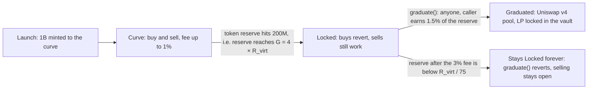

# Startpad launchpad

Startpad is MySphere's bonding-curve launchpad. Anyone can launch a token in one transaction; it trades against a math curve until the curve fills, then graduates into a Uniswap v4 pool whose LP position is locked inside a vault. No admin keys, no pause, no upgrades. Every rule is fixed in immutable contracts.

One number sets the scale of everything else. The virtual reserve $R_{virt}$ is a **constructor argument** of `CurveLaunchpad`, not a constant, so it differs per deployment and per network. The graduation target, the market cap at graduation, the largest single buy and the smallest pool the contract will open are all multiples of it:

| Derived value | Formula | On a deployment with $R_{virt} = 0.75$ ETH |
| --- | --- | --- |
| Graduation target $G$ | $4 \times R_{virt}$ | 3 ETH |
| Market cap at launch | $R_{virt}$ | 0.75 ETH |
| Market cap at graduation | $25 \times R_{virt}$ | 18.75 ETH |
| Minimum pool size `MIN_LP_ETH` | $R_{virt} / 75$ | 0.01 ETH |
| Largest single buy `MAX_BUY` | $132 \times R_{virt}$ | 99 ETH |

Everything below is written as a formula for that reason. If you want the number for a specific token, read `R_VIRT()` off the launchpad that created it.

## The three phases

`Curve`, `Locked` and `Graduated` are the contract's own state names. The badge on the board, the headings here and the `state` you read from `CurveLaunchpad` all say the same word.

| Phase | What you can do | What happens next |
| --- | --- | --- |
| **Curve** | Buy and sell against the curve. Every trade pays the launch's fee (up to 1%). Quotes come from `quoteBuy` / `quoteSell`. | The buy that would push the token reserve below 200M is trimmed to land exactly on it, so the reserve arrives at $G = 4 \times R_{virt}$ and the curve locks in the same transaction. `CurveLocked` is emitted. |
| **Locked** | **Selling still works** and pays out of the same reserve. Buying reverts. Anyone may call `graduate()`. | `graduate()` takes a 3% fee, hands the rest to the vault, and the pool opens. If sells have drained the reserve too far first, `graduate()` reverts and the token stays here — see below. |
| **Graduated** | Trade in the Uniswap v4 pool. The curve is closed for good: `buy` and `sell` revert with `AlreadyGraduated`. | Nothing further is scheduled. Fees accrue on every swap and anyone can call `harvest()` to book them. |

### A curve can stay Locked forever

`graduate()` computes the 3% graduation fee first, then checks what is left:

$$e_{LP} = e - 0.03\,e \qquad \text{must satisfy} \qquad e_{LP} \ge \texttt{MIN\_LP\_ETH} = \frac{R_{virt}}{75}$$

If it does not, the call reverts with `ReserveTooSmallToGraduate`. The reason is stated in the contract: a pool seeded with dust is unusable and impossible to clean up afterwards, so it is better not to open one.

This is reachable. In `Locked` state buys are closed and sells are open, so the reserve can only fall. A token whose holders sell most of the way out while it waits for a graduation call ends up below the floor **permanently**: it stays `Locked`, `graduate()` reverts forever, and no pool is ever opened. Selling keeps working the whole time, so nobody is trapped holding it, but nothing comes after. On a deployment with $R_{virt} = 0.75$ ETH, the floor is a reserve of about 0.0103 ETH before the fee.

## What it does

Each launch mints a fixed 1,000,000,000 supply once, straight to the curve. Up to 800M sells on the curve; the contract keeps `T_MIN` = 200M as the curve's floor and hands that 200M to the vault at graduation. There is no creator allocation. A creator's pre-buy is a normal buy on the same curve, at the same fee, filled in the same transaction that creates the token, so no sniper can get in first.

Not all of that 200M reaches the pool — see "What happens at graduation" below.

## Where it runs

| Network | Token standard | $R_{virt}$ | Target $G = 4 R_{virt}$ | Market cap at graduation $= 25 R_{virt}$ |
| --- | --- | --- | --- | --- |
| Base mainnet (default) | B20 | 0.75 ETH | 3 ETH | 18.75 ETH |
| Base Sepolia (testnet) | B20 | 0.75 ETH | 3 ETH | 18.75 ETH |
| Robinhood Chain | plain ERC-20 | 0.75 native | 3 native | 18.75 native |
| Arc mainnet | plain ERC-20 | 1250 USDC | 5000 USDC | 31250 USDC |
| Arc testnet | plain ERC-20 | 250 USDC | 1000 USDC | 6250 USDC |
| Perp markets (Base mainnet) | B20 | 1875 perp units | 7500 perp units | 46875 perp units |

Two notes on that table. Testnets get redeployed: a Base Sepolia launchpad deployed on 2026-08-31 runs $R_{virt} = 0.25$ ETH, i.e. a 1 ETH target, while the address the app points at today runs 0.75. And Arc's native unit is USDC, not ETH, so the same bytecode counts the same curve in dollars. Both are the same reason to read `R_VIRT()` rather than trust a number in prose.

B20 is Base's network-native token standard, and its factory precompile exists only on Base. Robinhood Chain and Arc therefore use `PlainTokenFactory` and launch ordinary ERC-20s. Everything else — the curve, the fees, the graduation path — is identical.

These constants are the same on every deployment: total supply 1e9, `T_MIN` 200M, `GRAD_FEE_BPS` 300, `LAUNCH_WINDOW` 300 s, `POOL_FEE` 3000 (0.30%), `POOL_TICK_SPACING` 60, hook fee 1%, `PROTOCOL_SHARE_BPS` 3000.

## The board

- The market list sorts by New, Trending, About to graduate, Graduated, or All, in a grid or a table, with search across names, symbols, and creators.
- Each card shows the state (Curve, Locked, Graduated), the reserve raised with a progress bar toward that network's target, volume, holders, age, and a price sparkline.
- A live ticker at the top streams every buy and sell as it lands onchain.
- King of the hill highlights the live token with the highest reserve.
- Board stats, Top launches, Top volume, and Top earnings sum the board from the contracts' own events; Top earnings ranks creators by accrued fees counted to the wei.
- My tokens appears when your wallet is connected: your launches, everything claimable across the launchpad, hook, and vault, and one Claim all button.
- Every card and table row has a Share button for X, Farcaster, Telegram, WhatsApp, Facebook, Reddit, your phone's own share sheet, or a copied link.
- The board's own mini trade panel is deliberately minimal: it uses the same default slippage buffer as the token page, but without the selector. The full token page is where you choose.

## Each token's page

Every token has its own page with a candlestick or line chart built from onchain events (1m, 5m, and 1h intervals), a trade panel with live quotes, stats (price, market cap, reserve, volume, trades, holders, age), and tabs for trades, holders (with badges for the curve, vault, hook, pool, and dead-address balances), and info. The creator, verified by a wallet signature, can edit the token's logo, description, and links from the info tab.

The trade panel defaults to a **3% slippage buffer**, with 1% / 3% / 5% to choose from; the choice applies to curve trades and to pool trades alike. The board's mini panel uses that same 3% default and offers no selector.

Share is in the page header too. A shared token link previews as a card generated at request time: the multiple the price has made since the curve's first block, the price line rebuilt from the contract's own trade events, the reserve raised against that network's target, and the number of wallets that have bought. In Base App and other Farcaster clients the same link opens as an embed with a Trade button, so the token page loads inside the app instead of a browser tab.

## How to use it

1. Open [/startpad](/startpad). It opens on Base mainnet by default; the header switcher also offers Robinhood Chain and Arc mainnet, both with real money. Testnets (Base Sepolia, Arc testnet) are hidden from it. The same menu holds Perp memes, Calls and $SPHERE. Switching network repaints the launchpad in that network's colours, so you can tell at a glance which market you are looking at.
2. Connect a wallet funded for that network: real ETH on Base mainnet, native funds on Robinhood Chain, USDC on Arc mainnet (test funds on the hidden testnets).
3. Launch with a name, symbol, and logo (a launch does not go out without one). Quick launch uses defaults and takes an optional pre-buy. Creator setup additionally sets the trade fee (up to 1%), your share of it (up to 70%), up to 8 fee receivers, an auto-buyback slice, a per-wallet buy cap for the first 5 minutes, and on B20 networks an optional vanity token address you mine in your own browser. Everything chosen at launch is immutable afterwards.
4. Trade by buying or selling against the curve. The quote you see (`quoteBuy` / `quoteSell`) is what the trade returns.
5. Claim your fees. They are pull-based. Your earnings accrue in the network's native currency; call `claim()` to collect. Anyone can pay gas to deliver your balance to you, never to themselves.
6. When the reserve reaches $4 \times R_{virt}$ the curve locks. Call `graduate()`: it is permissionless and pays the caller 1.5% of the reserve at the moment of the call.

### Sniper protection is off in Quick launch

The contract's own default per-wallet cap is `WINDOW_ADDR_CAP` = 16M tokens for the first `LAUNCH_WINDOW` = 300 seconds, and that is what the plain `launch()` function uses. **The app's Quick launch does not use it.** It calls `launchAdvanced` with `windowCap` set to the full supply, which means no cap at all — because the cap applies to the creator's pre-buy too, and a 0.1 ETH pre-buy on a 0.75 ETH curve is already about 116M tokens, so a 16M cap would revert most launches with a real pre-buy.

If you want sniper protection, use **Creator setup** and set the cap there, sized so your own pre-buy fits under it. The cap can never be changed after launch.

## How it flows

## The math

The curve is constant-product with a virtual reserve $R_{virt}$ that is never paid out. With real reserves $e$ (native currency) and $t$ (tokens):

$$(R_{virt} + e)\cdot t = k$$

Spot price:

$$P = \frac{R_{virt} + e}{t}$$

A buy adds net value $\Delta e$ (after the fee) and returns:

$$\Delta t = t - \frac{k}{R_{virt} + e + \Delta e}$$

A sell of $\Delta t$ tokens returns gross:

$$\Delta e = (R_{virt} + e) - \frac{k}{t + \Delta t}$$

The starting price is $R_{virt} / T_0$, so the market cap at launch is exactly $R_{virt}$. Selling $C = 800\text{M}$ tokens drops $t$ from $T_0 = 1\text{B}$ to $T_{min} = 200\text{M}$, so the price rises by

$$\left(\frac{T_0}{T_0 - C}\right)^2 = \left(\frac{1000}{200}\right)^2 = 25\times$$

giving a market cap at graduation of $25 \times R_{virt}$. The threshold is checked on the **token** reserve reaching $T_{min}$, and the amount collected at that point is

$$G = R_{virt}\cdot\frac{C}{T_0 - C} = 4 \times R_{virt}$$

The pool opens at exactly that price, $T_{min} / (R_{virt} + G) = T_{min} / (5 R_{virt})$ tokens per unit, encoded as `SQRT_PRICE_TERMINAL` and derived in the constructor from $R_{virt}$ so the two can never drift apart.

## What happens at graduation

**Where the liquidity goes.** `graduate()` takes `GRAD_FEE_BPS` = 3% of the reserve, sends the remaining $e_{LP}$ and the full 200M token reserve to the `LiquidityVault`, and the vault opens the pool and seeds one full-range position at the curve's closing price.

The vault sizes that position **from the value side**, not from the token side: it computes the liquidity that $e_{LP}$ supports and then supplies whatever token amount that liquidity requires. That amount is smaller than 200M. At a clean graduation, where the curve locked and nobody sold in between:

$$\text{tokens into the pool} \;\approx\; e_{LP}\cdot\frac{T_{min}}{5 R_{virt}} \;=\; 0.97 \cdot 4R_{virt}\cdot\frac{200\text{M}}{5R_{virt}} \;\approx\; 155.2\text{M}$$

The $R_{virt}$ cancels, so that figure is the same on every network: roughly **155M tokens, about 15.5% of supply, enter the pool**, and the leftover **roughly 45M is transferred to `0x000000000000000000000000000000000000dEaD`**. That is a transfer to a dead address, not a change to `totalSupply` — the supply stays 1,000,000,000 and the dead address simply holds a balance nobody can move. If holders sold during `Locked`, $e_{LP}$ is smaller and both figures move. The exact split for a given token is in its `Graduated` event: `amount0` (value into the pool), `amount1` (tokens into the pool) and `toDead`.

**Who owns the LP afterwards.** The `LiquidityVault` does. On Uniswap v4 a position has no ownership NFT: it is keyed by `(owner, tickLower, tickUpper, salt)`, and the owner is whichever address called `modifyLiquidity`. The vault has exactly two `modifyLiquidity` calls in the whole file — the seeding one, whose delta is a `uint128` cast to `int256` and therefore cannot be negative, and the harvesting one, whose delta is the literal `int256(0)`. There is no `owner`, `pause`, `upgrade`, `withdraw`, `sweep` or `rescue`, and no function anywhere that accepts an `int256` from a caller.

So the correct sentence is: **the liquidity is locked in a contract with no exit.** It is *not* burned, and the difference matters — a burned position would strand its trading fees forever, and collecting those fees is exactly why the vault exists instead of `0x…dEaD`.

**What it costs to trade after.** 1.30% of the swap: 0.30% to the pool's LP position (`POOL_FEE` = 3000) plus 1% taken by the hook in `afterSwap`. Both are covered in the fee table below.

**What the creator keeps earning.** The curve fee stops the moment the curve closes, and two streams replace it: the vault's share of the 0.30% LP fee and the hook's 1%. Both are split 70% creator / 30% protocol, and both keep paying for as long as the pool is traded.

## Where the money goes

| Recipient | Paid on | How much | Currency |
| --- | --- | --- | --- |
| Creator (and up to 8 receivers they name) | Every curve buy and sell | Up to 70% of the launch's trade fee, itself at most 1% (`MAX_FEE_BPS` = 100) | Native |
| Protocol | Every curve buy and sell | The remaining share, at least 30% (`MAX_CREATOR_SHARE_BPS` = 7000) | Native |
| Whoever calls `graduate()` | Once, at graduation | 1.5% of the reserve **at the moment of the call** — half of `GRAD_FEE_BPS` = 300 | Native |
| Protocol | Once, at graduation | The other 1.5% | Native |
| The vault's LP position → 70% creator / 30% protocol | Every v4 swap | 0.30% of the swap (`POOL_FEE` = 3000), accrued to the position and booked by `harvest()` | Both sides |
| The hook → 70% creator / 30% protocol | Every v4 swap | 1% of the swap, taken in the unspecified currency by `afterSwap` | Both sides |

The graduation reward is a **percentage, not a fixed amount**. On a 3 ETH target it is 0.045 ETH only if the reserve is still full; if holders sold while the curve was `Locked`, the caller gets 1.5% of whatever is actually there.

The 30% protocol floor is enforced in the contracts (`PROTOCOL_SHARE_BPS` = 3000 in both the vault and the hook, checked against each other at deployment), so it binds even a direct caller who bypasses the form. Auto-buyback spends only the creator's own share of pool fees to buy the token and send it to `0x…dEaD`; the protocol's 30% is never touched. Every accrual is pull-based: `harvest()` and `claim()` are permissionless, and a caller cannot redirect anything to themselves.

## After graduation

**Where do I trade now?** In the pool. On Base mainnet the token page keeps a Buy/Sell box after graduation: it quotes through Uniswap's `V4Quoter` (so the number you see is already net of the 0.30% and the 1%) and routes the swap through the Universal Router. On the other networks there is no in-app swap box — the page shows the pool id and a link to the `PoolManager`, and you trade through any v4 router or aggregator.

**What happened to my tokens?** Nothing. Balances are untouched by graduation; only the counterparty changed. The curve stops quoting and the pool starts.

**Is the liquidity locked?** Yes — the vault's position cannot be withdrawn by anyone, including us (see above). Locked, not burned: fees still leave the vault, capital does not.

**Can anyone add liquidity?** Yes, and this is worth being precise about. The hook's only gate is `beforeInitialize`, which restricts **who may open the hooked pool** — the vault, once, at graduation. It sets no liquidity-related hook flags and does not gate swaps at all: its flags are `beforeInitialize`, `afterSwap` and `afterSwapReturnsDelta`, nothing else. So anyone may add their own liquidity to that pool and withdraw it again later, anyone may open a **separate** pool for the same token without the hook, and any v4 router or aggregator can trade either. Third-party liquidity dilutes the vault's share of the 0.30% LP fee; the hook's 1% is unaffected, because it is taken on every swap in the hooked pool regardless of who provided the liquidity.

**Who gets the fees?** See the table above. `harvest()` on the vault and the hook's own accrual are both permissionless — the caller gets nothing for it, and the direction is fixed in immutable storage, so anyone can pay the gas to make the creator's balance grow.

**Why does the chart change?** The curve line ends at graduation, because the curve stops trading there. After that the chart is rebuilt from the pool's own `Swap` events, so it keeps running; on Base you can also switch the chart source to DexScreener. The header's live price is read from the pool through `StateView`, and `StateView` has a confirmed address only on **Base mainnet** — on the other networks that read is deliberately silent, so the page keeps showing the last curve price until swaps arrive.

## Check it onchain

Everything is verifiable on the network's block explorer. Launchpads:

| Network | `CurveLaunchpad` | Explorer |
| --- | --- | --- |
| Base mainnet (v2, current) | `0xb5C71DE0B6b2280A7b05ECDdd9F22a895A5E243e` | [basescan.org](https://basescan.org) |
| Base mainnet (v1, legacy: old curves and fee balances only, no new launches) | `0xCF541A7EcE881945833ff1680dFc067C5Dd4cE2D` | [basescan.org](https://basescan.org) |
| Arc mainnet | `0xD5f65Cfbe6A1AA1B6f82CBE0A336DDFCD39a5340` | [arc-scan.org](https://arc-scan.org) |
| Base Sepolia (v2) | `0x74aB8aD577fB49dc4930D8BBAD144c7a230143e6` | [sepolia.basescan.org](https://sepolia.basescan.org) |
| Robinhood Chain | `0x712E93401b455d226284BbA873cE13CC1492B22f` | [robinhoodchain.blockscout.com](https://robinhoodchain.blockscout.com) |
| Arc testnet | `0xe984986f4F1E067f697b548D5fe942813d03Da37` | [testnet.arcscan.app](https://testnet.arcscan.app) |

The rest of the current Base mainnet set (v2, live since 2026-10-11 after the Cobalt hard fork): `LiquidityVault` `0x019098A6e1377ABE2a40faF5643EE1cC5459AFF3`, `B20LaunchHook` `0xE0BCc49d92bF9e928F7010C1e5884E146bA92044`, `B20TokenFactoryV2` `0xF1DAd68f9B0b00A80E993286419AD03e9380e7B0`, and on Arc mainnet `LiquidityVault` `0x49FD3A54b23A0ee1d6A7720F493618F5CCF4681D`, hook `0x9669d2809710aD8218793e0CD55317Ccd984E044`, factory `0x04bdaD462B66B152689076975db1197766A69568`. The v1 set (vault `0x6108aDCb…`, hook `0x71028Ea6…`, factory `0xEC7db55B…`) stays readable but no longer starts tokens. Common to Base: Uniswap v4 `PoolManager` `0x498581fF718922c3f8e6A244956aF099B2652b2b`, protocol fee recipient `0x83E2DE974FC6B866FDb78AEFa5596d58fDc4142F`. The full per-network address table sits in the footer of [/startpad](/startpad) itself, with explorer links.

- Read `R_VIRT()` on the launchpad to get the scale, and `MIN_LP_ETH()`, `MAX_BUY()` and `SQRT_PRICE_TERMINAL()` to confirm they follow from it.
- Each launch emits a `Launched` event; every trade emits `Bought` / `Sold` with the reserves after.
- Every fee accrual, to the wei per receiver, is a `FeeAccrued` event, and the sums reconcile with `claimable()`.
- Lock and graduation emit `CurveLocked` and `Graduated`; `Graduated` carries the pool id, the caller, the amounts that went into the pool, the amount sent to the dead address, the graduation fee and the price the pool opens at.
- The vault emits `Seeded` when the position is created and `Harvested` / `LpFeeAccrued` every time fees are booked.

Token logos and descriptions are off-chain (ERC-20 has no onchain logo), served through the app's token list and editable only by the creator the chain verifies. The onchain contracts are the source of truth for supply, reserves, fees, and state; the metadata layer is not.
