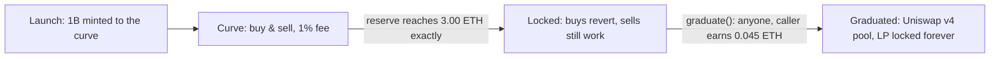

# Startpad launchpad

Startpad is MySphere's bonding-curve launchpad. Anyone can launch a token in one transaction; it trades against a math curve until it collects exactly 3.00 ETH, then graduates into a locked Uniswap v4 pool. No admin keys, no pause, no upgrades. Every rule is fixed in immutable contracts.

## What it does

Each launch mints a fixed 1,000,000,000 supply once, straight to the curve. Up to 800M (80%) sells on the curve; the remaining 200M (20%) is moved into a Uniswap v4 pool at graduation. There is no creator allocation. A creator's pre-buy is a normal buy on the same curve, at the same fee, filled in the same transaction that creates the token, so no sniper can get in first.

While a token is on the curve you buy and sell against a constant-product formula (details below). When the curve's ETH reserve reaches 3.00 ETH the token locks (buys revert, sells still work), and anyone can call `graduate()` to seed the pool. After that, trading happens in the v4 pool.

Startpad runs on Base mainnet with real ETH, and that is the default network. It also runs on Base Sepolia (a testnet, where the ETH has no real value) and on Robinhood Chain. On Base mainnet and Base Sepolia tokens use the network-native B20 standard; on Robinhood they are plain ERC-20s, because there is no B20 precompile there. The mainnet contracts are verified on BaseScan.

## The board

- The market list sorts by New, Trending, About to graduate, Graduated, or All, in a grid or a table, with search across names, symbols, and creators.
- Each card shows the state (Curve, Locked, Graduated), ETH raised with a progress bar toward 3.00 ETH, volume, holders, age, and a price sparkline.
- A live ticker at the top streams every buy and sell as it lands onchain.
- King of the hill highlights the live token with the highest reserve.
- Board stats, Top launches, Top volume, and Top earnings sum the board from the contracts' own events; Top earnings ranks creators by accrued fees counted to the wei.
- My tokens appears when your wallet is connected: your launches, everything claimable across the launchpad, hook, and vault, and one Claim all button.
- Every card and table row has a Share button for X, Farcaster, Telegram, WhatsApp, Facebook, Reddit, your phone's own share sheet, or a copied link.

## Each token's page

Every token has its own page with a candlestick or line chart built from the contract's events (1m, 5m, and 1h intervals; the chart ends at graduation, because after that trading lives in the pool), a trade panel with live quotes and a 0.5% slippage buffer, stats (price, market cap, reserve, volume, trades, holders, age), and tabs for trades, holders (with badges for the curve, vault, hook, pool, and burned balances), and info. The creator, verified by a wallet signature, can edit the token's logo, description, and links from the info tab.

Share is in the page header too. A shared token link previews as a card generated at request time: the multiple the price has made since the curve's first block, the price line rebuilt from the contract's own trade events, ETH raised against the 3.00 ETH target, and the number of wallets that have bought. In Base App and other Farcaster clients the same link opens as an embed with a Trade button, so the token page loads inside the app instead of a browser tab.

## How to use it

1. Open [/startpad](/startpad). It opens on Base mainnet by default, and the header switcher also offers Base Sepolia and Robinhood Chain.
2. Connect a wallet funded for that network: real ETH on Base mainnet, test ETH on Base Sepolia.
3. Launch with a name, symbol, and logo (a launch does not go out without one). Quick launch uses defaults and takes an optional pre-buy. Creator setup additionally sets the trade fee (up to 1%), your share of it (up to 70%), up to 8 fee receivers, an auto-buyback slice, a per-wallet buy cap for the first 5 minutes, and on B20 networks an optional vanity token address you mine in your own browser. Quick launch sets no buy cap; if you want sniper protection, set it in Creator setup. Everything chosen at launch is immutable afterwards.
4. Trade by buying or selling against the curve. The quote you see (`quoteBuy` / `quoteSell`) is what the trade returns.
5. Claim your fees. They are pull-based. Your earnings accrue in ETH; call `claim()` to collect. Anyone can pay gas to deliver your balance to you, never to themselves.
6. When the reserve hits 3.00 ETH, call `graduate()`. It is permissionless and pays the caller 0.045 ETH.

## How it flows

## The math

The curve is constant-product with a virtual ETH reserve of $R_{virt} = 0.75$ ETH that is never paid out. With real reserves $e$ (ETH) and $t$ (tokens):

$$(R_{virt} + e)\cdot t = k$$

Spot price:

$$P = \frac{R_{virt} + e}{t}$$

A buy adds net ETH $\Delta e$ (after the fee) and returns:

$$\Delta t = t - \frac{k}{R_{virt} + e + \Delta e}$$

A sell of $\Delta t$ tokens returns gross ETH:

$$\Delta e = (R_{virt} + e) - \frac{k}{t + \Delta t}$$

The starting price is $7.5\times10^{-10}$ ETH (market cap 0.75 ETH). Selling 800M tokens drops $t$ from 1B to 200M, so the price rises by $\left(\tfrac{T_0}{T_0 - C}\right)^2 = \left(\tfrac{1000}{200}\right)^2 = 25\times$, giving an 18.75 ETH market cap at graduation. The threshold is checked on the token reserve reaching 200M, which corresponds to exactly 3.00 ETH collected.

## Fees

| Fee | Amount | Split |
| --- | --- | --- |
| Curve trade fee | up to 1% of each buy & sell (the form defaults to 1%) | up to 70% creator / min 30% protocol |
| Graduation fee | 3% of the 3.00 ETH reserve = 0.09 ETH | 0.045 to the `graduate()` caller, 0.045 to protocol |
| Pool hook fee | 1% of every v4 swap | 30% protocol always; creator's 70% split between ETH payout and optional auto-buyback |

The 30% protocol floor is enforced in the contract, so it binds even a direct caller who bypasses the form. Auto-buyback spends only the creator's own share of ETH pool fees to buy and burn the token (sent to `0x…dEaD`); the protocol's 30% is never touched. The LP position lives in the vault forever; only its fees are claimable, never the liquidity.

## Check it onchain

Everything is verifiable on the network's block explorer. On Base mainnet the `CurveLaunchpad` is `0xCF541A7EcE881945833ff1680dFc067C5Dd4cE2D` on [basescan.org](https://basescan.org); on Base Sepolia it is `0x4Cc0ff50912400eeeC38db45ef5CEf00f5Ad1A48` on [sepolia.basescan.org](https://sepolia.basescan.org); on Robinhood Chain it is `0x712E93401b455d226284BbA873cE13CC1492B22f` on [robinhoodchain.blockscout.com](https://robinhoodchain.blockscout.com). The full per-network address table (vault, hook, token factory) sits in the footer of [/startpad](/startpad) itself, with explorer links.

- Each launch emits a `Launched` event; every trade emits `Bought` / `Sold` with the reserves after.
- Every fee accrual, to the wei per receiver, is a `FeeAccrued` event, and the sums reconcile with `claimable()`.
- Lock and graduation emit `CurveLocked` and `Graduated` (the latter carries the pool id and the price the pool opens at).

Token logos and descriptions are off-chain (ERC-20 has no onchain logo), served through the app's token list and editable only by the creator the chain verifies. The onchain contracts are the source of truth for supply, reserves, fees, and state; the metadata layer is not.
