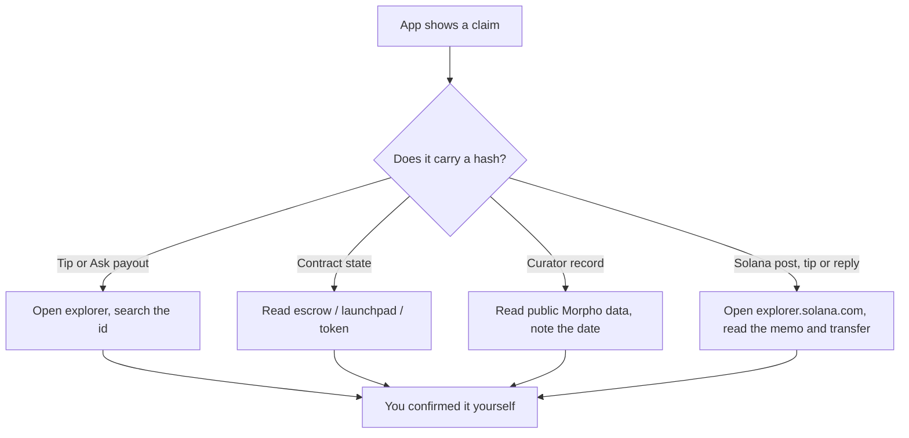

# Verify it onchain

MySphere's whole promise is that the money is real, not a number in our database. This page is the how-to: take any claim the app makes and check it yourself in a public block explorer, with no help from us.

## What it does

Most money events in MySphere carry a transaction hash you can open in a block explorer. On Solana the transaction itself is the record: a post's receipt, its Proof of Bags balance, a SOL tip and a paid reply are all read on [explorer.solana.com](https://explorer.solana.com), and SOL tips are not recorded by MySphere at all. Some things are onchain contracts you can read directly (the Ask escrow, the Startpad launchpad and its B20 tokens). One thing, the Morpho curator record, is not a transaction at all. It's a dated reading of public Morpho data, and this page says so plainly so you don't go hunting for a hash that was never minted.

## How to use it

1. Copy the hash or address the app shows you (tip receipt, Ask payout, token page).
2. Pick the right explorer for the network it lives on (table below).
3. For a tip, paste the id into the explorer's search box, not a raw `/tx/` URL. Base Pay tips record a userOp id (an ERC-4337 order), which is 32 bytes just like a transaction hash but isn't one. The search box resolves both; a hard `/tx/` link only works for real transactions.
4. For an Ask or a Startpad token, open the contract's address and use the "Read Contract" / "Events" tabs to see the numbers for yourself.

## Claim → where to verify

| Claim | Where to verify |
| --- | --- |
| Base tip | `basescan.org`, search the tip id |
| Robinhood tip | `robinhoodchain.blockscout.com`, search the tip id |
| Ethereum / Celo / World / Linea / Camp tip | `etherscan.io` / `celoscan.io` / `worldscan.org` / `lineascan.build` / `camp.cloud.blockscout.com` |
| Arc tip (testnet) | `testnet.arcscan.app`, search the tip id |
| Solana post receipt | `explorer.solana.com/tx/<signature>`: a Memo v2 instruction starting `mysphere:post`, with the post id, the signing Solana address and the post's first 280 bytes; the fee payer is that same address |
| Proof of Bags balance | The same transaction: a Memo v1 instruction starting `mysphere:bags` lists the tokens, and Token Balances shows the wallet's token account at posting (a zero balance, or no row at all, means it held none) |
| SOL tip | `explorer.solana.com`: a transfer to the post's Solana wallet plus a memo starting `mysphere:tip` with the post id; MySphere keeps no record of it |
| Paid reply | The "paid reply" badge links its transaction: a memo starting `mysphere:reply` with the post id and the reply text, plus a transfer of at least 0.001 SOL to the post's Solana wallet |
| Ask funded / seat awarded / resolved / claimed | Ask escrow contract on Base (`AskFunded`, `SeatAwarded`, `AskResolved`, `AskExpired`, `Claimed` events) |
| SOL Ask payout | `explorer.solana.com`: one System Program transfer from the author's linked Solana wallet to the answerer's, with a memo `mysphere:ask|v1|<askId>|<answerId>` |
| Startpad launch / buy / sell / graduation | Launchpad `0xb5C71DE0B6b2280A7b05ECDdd9F22a895A5E243e` on Base mainnet (`basescan.org`; the earlier `0xCF541A7EcE881945833ff1680dFc067C5Dd4cE2D` is legacy and only holds old curves); `0xD5f65Cfbe6A1AA1B6f82CBE0A336DDFCD39a5340` on Arc mainnet; `0x74aB8aD577fB49dc4930D8BBAD144c7a230143e6` on Base Sepolia (`sepolia.basescan.org`); `0x712E93401b455d226284BbA873cE13CC1492B22f` on Robinhood (Blockscout) |
| B20 token supply cap / no admin roles | Read the token address on the explorer, total supply is fixed at launch |
| Morpho curator change | Off-chain, dated reading of public Morpho data (no single MySphere hash) |

## How it flows

## The math

An Ask escrow holds a budget in USDC. When unused budget returns to the author (expired or unfilled), the contract takes an immutable fee. You can reproduce the split from the contract's `feeBps`:

$$\text{fee} = \left\lfloor \frac{\text{budget} \times \text{feeBps}}{10000} \right\rfloor, \qquad \text{toAuthor} = \text{budget} - \text{fee}$$

The fee rounds down, so the author's share is always the exact remainder. The two add back to the budget to the cent. Payouts to answerers are the per-answer stake times the seats awarded; nothing is ever paid without a `SeatAwarded` log carrying the answer's reference.

## Check it onchain

- For the Ask escrow on Base (USDC), open the escrow address on `basescan.org`, call `escrowFor(author, askId)` to see the locked budget, seats and deadline, and `claimable(account)` to see a balance waiting to be collected. `FEE_RECIPIENT()` and the fee are immutable. It's also deployed on Base Sepolia (chainId 84532) for testing.
- The Startpad launchpad addresses are in the table above, and the full per-network set (vault, hook, token factory) sits in the footer of [/startpad](/startpad) with explorer links. Startpad runs on Base mainnet (the default), Robinhood Chain and Arc mainnet; testnets are hidden from its switch. Read a B20 token to confirm its fixed supply and that it exposes no owner/admin functions.
- For Solana, the exact memo formats and what each one proves are on [Solana: bags, tips & replies](/Docs/solana). MySphere deploys no program on Solana: posts and replies use Solana's Memo Program (v2 `MemoSq4gqABAXKb96qnH8TysNcWxMyWCqXgDLGmfcHr`, Proof of Bags v1 `Memo1UhkJRfHyvLMcVucJwxXeuD728EqVDDwQDxFMNo`) and tips use plain System Program transfers.
- There's one honest limit. The Morpho curator record is verifiable only in the sense that you can read the same public Morpho data we did. It isn't a MySphere transaction, so treat its timestamp as a dated snapshot, not a hash.
