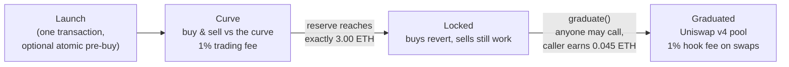
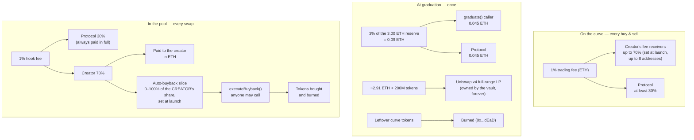

# MySphere Launchpad — Technical Dossier

> **Zasada utrzymania (dla zespołu):** ten plik aktualizujemy przy KAŻDEJ zmianie
> launchpada — kontraktów, opłat, adresów lub UI, jeśli zmienia zachowanie opisane
> tutaj. Stan wdrożenia i adresy: `docs/LAUNCHPAD-STAN.md`.
>
> Last updated: 2026-08-11 (v3 + internal-audit addendum, §7) · deployments: `0x4Cc0...1A48` (Base Sepolia,
> B20 tokens) and `0x712E...B22f` (Robinhood Chain MAINNET, plain ERC-20 tokens
> — no B20 precompile there; same rules, all four contracts verified on
> Blockscout, smoke-tested with real transactions; the frontend has a network
> switcher for both)
> · creator-first split 70/30 · buyback funded from the creator's share
> · sniper protection is optional (creator can disable it at launch)

MySphere Launchpad launches **B20 tokens** (Base's network-native, ERC-20-compatible standard — created by the network's factory precompile, born admin-less with supply cap = total supply) on a bonding curve. When the curve
collects **exactly 3.00 ETH**, the token *graduates*: liquidity moves into a
**Uniswap v4 pool** with a custom fee hook. There are **no admin keys, no pause,
no upgrades** — every rule below is fixed in immutable contracts. All payouts are
**pull-based** (you claim; nothing is pushed) and **creator earnings are paid in
ETH**, not in the token.

## 1. Token lifecycle

- The pool opens **at the exact price the curve closed at** — nobody who bought
  the top of the curve is instantly underwater.
- `graduate()` is permissionless: the caller reward (half of the 3% graduation
  fee) pays for the gas race, so graduation doesn't depend on us.

## 2. The curve in numbers

Constant-product curve with a **virtual ETH reserve**: `(0.75 ETH + ethReserve) ×
tokenReserve = k`. Spot price = `(0.75 ETH + ethReserve) / tokenReserve`.

| Parameter | Value |
| --- | --- |
| Total supply (minted once, to the curve) | 1,000,000,000 |
| Sold on the curve | up to 800,000,000 (80%) |
| Moved to the pool at graduation | 200,000,000 (20%) |
| Starting price | 0.00000000075 ETH |
| Starting market cap | 0.75 ETH |
| Graduation trigger | reserve = **3.00 ETH exactly** |
| Market cap at graduation | 18.75 ETH (**25×**) |
| Sniper window | first 5 minutes: per-wallet buy cap — default 16M tokens; the creator can lower it, raise it, or **disable protection entirely** (cap = full supply) |
| Creator allocation | **none** — a pre-buy is a normal buy on the same curve, in the same launch transaction |
| Creator fee ceiling | **70% of every fee stream** — same ratio as PONS, everywhere |

Solvency invariant: selling every circulating token back returns exactly the
ETH reserve — the virtual 0.75 ETH is never paid out.

## 3. Where every fee goes

Three fee streams, one ratio — **the creator gets up to 70%, everywhere**:

1. **Curve trading fee (1%)** — split is chosen by the creator at launch:
   creator share **0–70%**, the rest (min 30%) to the protocol. The 30% floor
   is enforced **by the contract**, not by the form.
2. **Graduation fee (3% of reserve, one-time)** — half to whoever calls
   `graduate()`, half to the protocol.
3. **Pool hook fee (1% of every swap)** — the protocol always receives its
   **30%** in full. The creator's **70%** is then divided by the creator's own
   launch-time choice: how much is paid out in ETH and how much funds the
   auto-buyback. LP fees collected by `harvest()` follow the same 70/30 split.

### Auto-buyback — what it is and what it costs

- Funded **only from the creator's 70% share**, and **only from the ETH side**
  of post-graduation pool fees. Curve fees and the protocol's 30% are never
  touched — like Flaunch, the slider divides *the creator's own money* between
  "paid to me in ETH" and "buys & burns my token".
- Example at a 50% buyback setting: of a 1% swap fee, 0.30% goes to the
  protocol, 0.35% buys & burns, 0.35% is paid to the creator.
- The slice is accounted at `settle()` time; anyone can then execute a pending
  buyback; bought tokens go straight to `0x...dEaD`. Price impact per execution
  is capped in the hook, so a buyback can't be used to sandwich the pool.

## 4. What a creator configures at launch (immutable afterwards)

| Setting | Range | Default |
| --- | --- | --- |
| Name / symbol / metadata URI | free text; metadata can embed image + description | — |
| Trading fee | 0–1% | 1% |
| Creator share of that fee | 0–70% | 70% |
| Fee receivers | up to 8 addresses, shares sum to 100% | creator |
| Auto-buyback (slice of the creator's pool-fee share) | 0–100% | 0% |
| Sniper cap (first 5 min, per wallet) | any amount up to full supply (= protection off) | 16M |
| Pre-buy | any ETH amount, same curve & fee as everyone | 0 |

Nothing on this list has a setter. Changing any of it means launching a new
token.

## 5. Trust properties

- **No roles.** No owner, no pauser, no upgrader, no migration path. A bug is
  irreversible — which is also why the fee caps and floors bind *us* too.
- **Pull payments only.** `claim()` on the launchpad, `claimEth`/`claimToken`
  on the hook and the vault. Anyone may pay gas to deliver *your* balance to
  *you* (`claimFor`), never to themselves.
- **LP is locked forever.** The vault holds the full-range position; only the
  fees it earns are claimable (70% creator / 30% protocol), never the liquidity
  itself.
- **Honest UI.** The interface detects the deployed contract version on-chain
  (`MAX_BUYBACK_BPS` probe) and hides options the chain would reject. Logos and
  descriptions live off-chain (ERC-20 has no on-chain logo) — served through our
  token list, editable only by the creator verified on-chain.

## 6. Contracts

| Contract | Role |
| --- | --- |
| `CurveLaunchpad` | curve math, trading, fees, graduation |
| `LiquidityVault` | owns the v4 LP position, harvests LP fees |
| `B20LaunchHook` | 1% swap fee, buyback accounting, 70/30 split |
| `B20TokenFactory` | asks the network precompile to create each B20 token, then verifies supply, cap and the absence of any live role |

Current addresses and deploy block: `docs/LAUNCHPAD-STAN.md`.

## 7. Internal audit (2026-08-11) — backlog for the next deployment

> Adversarial 4-lens review (curve math · v4/hook · economics & MEV ·
> access-control / griefing), every finding put through an independent
> refutation pass. **22 raw findings → 13 survived; 0 critical, 0 high, no
> fund loss, nothing exploitable to steal funds.** 9 findings were refuted as
> intentional, documented design (listed at the end). The math scaffolding was
> re-checked numerically and is sound (terminal `sqrtPrice` = 5.786e32, start
> price 0.75e-9 ETH, exactly 25× and 18.75 ETH mcap at graduation). The live
> contracts are immutable, so everything below ships with the **next**
> deployment — except the two P1 items, which are runbook/comment changes.

### Mainnet-candidate build — applied 2026-08-11

Turning this backlog into the actual mainnet build. Verified against the full
suite (**125 passing**: unit + invariants + a new vanity suite) and a **real
Base-mainnet fork probe** (`launchpad:fork:base`, block 49837711).

- **Applied:** `MIN_SQRT_PRICE_X96` off-by-one → `4295128739`; buyback
  `MAX_BUYBACK_SLIPPAGE_BPS` `500 → 150` (worst-case per-execution leak ~9.75% →
  ~3%; comment no longer oversells it as a full sandwich defense); misleading
  comments (v4 slot / `launch` docstring / terminal-price direction / PoolKey
  hooks) corrected.
- **Reverted after testing:** the `quoteBuy`/`quoteSell` guard-parity fix. The
  suite showed it contradicts the *intentional* design (quotes return the raw
  math — 0 tokens for dust — while `buy`/`sell` enforce the guards) and broke the
  solvency invariant probe (`quoteSell(token, 0)` when nothing is circulating).
  Quotes stay state-parity only.
- **Not applied (as noted):** graduation-reward ramp, dust hook-fee threshold,
  8-receiver claim-time split — debatable or worse trade-offs.
- **Added (feature):** `launchVanity(bytes32 vanitySalt, …)` + `predictVanityToken`
  — user-chosen, mineable token addresses (the 4-char vanity). Default
  `launch`/`launchAdvanced` unchanged (blockhash, unpredictable). Safe despite
  predictability (hook gate blocks pool poisoning); front-run-safe (launchId folds
  `msg.sender`). Covered by `test/CurveLaunchpadVanity.test.ts`.
- **Fork-verified on real Base mainnet:** graduation through real
  `initialize`/`modifyLiquidity`; `POOLS_SLOT=6` reads the real PoolManager price
  (closes the P1 layout concern for Base mainnet); `afterSwap` positive delta
  settles exactInput **and** exactOutput on real v4.
- **Market-cap tiers:** considered, **not** added — marginal user value, biggest
  risk to the curve math; can ship later as a separate contract.
- **External audit:** deferred (owner's call), replaced by a harder internal
  adversarial pass; flagged as elevated risk before mainnet.

### Faza 4 review — 2026-08-11 (the "harder internal pass")

3 adversarial lenses (vanity path · buyback/constants · fresh sweep) + an
independent refutation of every finding. **5 raw → 0 confirmed, 2 plausible,
3 refuted.** The immutable delta (vanity + constants) is **verified clean**: the
verifiers explicitly confirmed no cross-creator/cross-path address collision, no
theft, no nonce corruption, no pool poisoning, `predictVanityToken` bit-identical
to the real launched address, reserves/invariants untouched, and the creator
dev-buy still first.

- **Only surviving item (both plausible findings, same issue):** a vanity address
  is public/mineable the moment `launchVanity` is broadcast, so a mempool observer
  can pre-stage snipes — a resistance the blockhash default path keeps. No fund
  loss, no code-correctness bug; it is the cost of opting into a predictable
  address. Mitigation is DOCS + UX: the `launchVanity` docstring now names the
  tradeoff, and the **vanity launch UI must warn and default to a tight
  `windowCap`** (a multi-address sniper defeats a loose one).
- **Refuted:** buyback clamp reverting at the v4 price floor (unreachable,
  fail-safe), tighter-150bps partial fills (intended/documented, keeper-runbook
  note only), `pendingBuybackEth` "stranding" (funds preserved by rollback,
  unreachable).

### P1 — deployment process (before mainnet)

- **[medium] v4 storage layout is validated only at the FIRST graduation, not
  at deploy.** `PoolStateReader.sqrtPriceX96` reads Slot0 via `extsload` at a
  hardcoded `POOLS_SLOT = 6` (`interfaces/IPoolManagerV4.sol:145-158`); the only
  on-chain check is `LiquidityVault._seed:500` (`revert PoolStateUnreadable`),
  which first runs at the first graduation of a whole deployment — after real
  curve ETH exists. On a chain whose PoolManager has a different storage layout,
  every token that reaches `T_MIN` is then permanently stuck in `Locked` (sells
  work; no pool, hook, or LP ever), with no admin recourse. The fork-probes
  (`launchpad-{base,robinhood}-fork-probe.json`) exercise each chain's real
  PoolManager bytecode, so Base + Robinhood are covered; the exposure is **new
  chains**. **Action: make one end-to-end graduation on each new chain's
  fork/testnet a HARD gate before mainnet; consider a constructor-time layout
  probe in the next `LiquidityVault`.** Note: `LAUNCHPAD-STAN.md` records that
  the full path-to-pool was never run on the *production* stack (only fork +
  mini-stack) — that is precisely this risk.
- **[low, misleading] Stale comments claim `launch()` validates the slot.**
  `interfaces/IPoolManagerV4.sol:140-143` and the `launch` docstring
  (`CurveLaunchpad.sol:745, 762-763` — "przygotowuje cztery pule" / "cztery
  transakcje initialize") describe the OLD design; `launch` no longer
  initializes any pool (the only `initialize` is in `_seed`, at graduation). A
  deployer trusting them could ship a new chain after testing only launch+buy
  and brick the first mainnet graduation. **Action: repoint the comments at
  `LiquidityVault._seed` / graduation.**

### P2 — tuning (next deployment, all immutable)

- **[low] Auto-buyback slippage is anchored to in-tx spot.**
  `MAX_BUYBACK_SLIPPAGE_BPS = 500` (~9.75% on price) is computed from a same-tx
  `spot` read (`B20LaunchHook.sol:500-502`), and `executeBuyback` is
  permissionless with caller-supplied `minTokensOut` (0 allowed). It bounds only
  the buyback's own move, not deviation from fair value. A clean sandwich is
  marginal/unprofitable at realistic depth (partial-fill refund + the attacker
  pays ~2.6% round-trip pool+hook fees), so this is defense-in-depth, not an
  exploit — but the comment (166-186) oversells it. **Action: tighten to
  ~100-150 bps, anchor to the terminal seed price or a short TWAP, require
  `minTokensOut > 0`, and correct the comment.**
- **[low] `quoteBuy` / `quoteSell` quote trades that revert.** `quoteBuy`
  (`CurveLaunchpad.sol:691-701`) omits the `BuyTooLarge` (>100 ETH) and
  `DustTrade` guards; `quoteSell` (717-724) omits `DustTrade`. A UI/bot trusting
  the quote submits a reverting tx. **Action: mirror the guards in the view
  functions (or document that they check state only).**
- **[low] Terminal-price comment is directionally wrong.** After Locked-state
  sells, the pool still opens at `SQRT_PRICE_TERMINAL`; the comment
  (`CurveLaunchpad.sol:1160-1164`) says this is "against the first pool trader" —
  true for a first *buyer*, but it FAVORS the first *seller* (who can
  `graduate()` + sell first into the terminal-priced, thin pool). Bounded,
  zero-sum among holders, no fund loss. **Action: correct the comment (or seed
  at `min(terminal, curve-current)`).**
- **[improvement, debatable] Graduation reward overpays the caller.** Flat
  1.5%-of-reserve (~0.045 ETH) is ~2000-12000× the ~375k-gas task cost; the
  surplus leaks to searchers/sequencer. A Dutch-style ramp would extend the
  Locked window (letting sellers thin the pool by more than is saved), so leave
  as-is unless deliberately revisited.

### Nits (next deployment)

- `MIN_SQRT_PRICE_X96 = 4295128740` is v4-min **+1** (true min `4295128739`);
  error is in the safe direction and the branch is ~unreachable — derive from
  `TickMath.getSqrtPriceAtTick(MIN_TICK)` (`B20LaunchHook.sol:164`).
- Dust swaps pay a min-1-unit (up to 100%) hook fee via `mulDivUp`
  (`B20LaunchHook.sol:459`); negligible at 18 decimals — document.
- The up-to-8 fee-receiver loop costs ~9k gas/receiver/trade forever
  (`CurveLaunchpad.sol:1271-1281`); bounded and creator-chosen — optional to
  accrue one bucket and split at claim time.

### Refuted (9) — confirmed intentional / documented

`afterSwap` delta sign (proven on Base **and** Robinhood forks + a live Sepolia
swap tx; only the "NIEPOTWIERDZONE" comment is stale) · `owed0 <= msg.value`
(fail-closed via the checked subtraction at `LiquidityVault.sol:547`) ·
`executeBuyback` no `minTokensOut` floor (the in-tx price limit already
protects; `minTokensOut=0` is a harmless no-op) · `FeeOverflow` guard (reachable
at `int128.min`, intentional assert) · `launch()` dev-buy above ~0.0122 ETH
reverts (the window cap applies to the creator by design; use `launchAdvanced`
with a higher `windowCap`) · JIT LPs dilute the LP fee stream (documented; a
locked LP still weakly beats burning) · Locked-window fee asymmetry thins the
pool (documented; pool depth dominates the fee delta) · the 5-min per-wallet cap
is sybil-bypassable (explicitly documented as NOT anti-bot).

> A separate `/code-review` pass on the live source is still running (4
> correctness angles done; awaiting pitfalls / efficiency / reuse). Its only
> overlap so far — the `LiquidityVault.sol:547` underflow — matches the refuted
> list above (fail-closed, funds safe). Update this section if it surfaces
> anything new.
