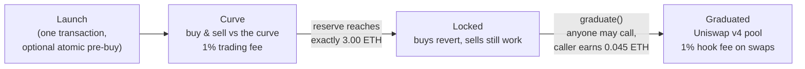
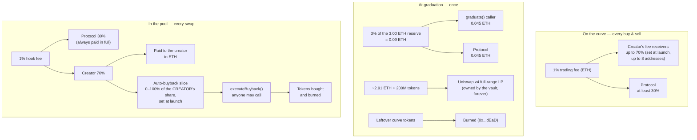

# MySphere Launchpad — Technical Dossier

> **Zasada utrzymania (dla zespołu):** ten plik aktualizujemy przy KAŻDEJ zmianie
> launchpada — kontraktów, opłat, adresów lub UI, jeśli zmienia zachowanie opisane
> tutaj. Stan wdrożenia i adresy: `docs/LAUNCHPAD-STAN.md`.
>
> Last updated: 2026-08-10 (evening) · deployment `0x811d...58ba` (Base Sepolia)
> · creator-first split 70/30 · buyback funded from the creator's share

MySphere Launchpad launches ERC-20 tokens on a bonding curve. When the curve
collects **exactly 3.00 ETH**, the token *graduates*: liquidity moves into a
**Uniswap v4 pool** with a custom fee hook. There are **no admin keys, no pause,
no upgrades** — every rule below is fixed in immutable contracts. All payouts are
**pull-based** (you claim; nothing is pushed) and **creator earnings are paid in
ETH**, not in the token.

## 1. Token lifecycle

- The pool opens **at the exact price the curve closed at** — nobody who bought
  the top of the curve is instantly underwater.
- `graduate()` is permissionless: the caller reward (half of the 3% graduation
  fee) pays for the gas race, so graduation doesn't depend on us.

## 2. The curve in numbers

Constant-product curve with a **virtual ETH reserve**: `(0.75 ETH + ethReserve) ×
tokenReserve = k`. Spot price = `(0.75 ETH + ethReserve) / tokenReserve`.

| Parameter | Value |
| --- | --- |
| Total supply (minted once, to the curve) | 1,000,000,000 |
| Sold on the curve | up to 800,000,000 (80%) |
| Moved to the pool at graduation | 200,000,000 (20%) |
| Starting price | 0.00000000075 ETH |
| Starting market cap | 0.75 ETH |
| Graduation trigger | reserve = **3.00 ETH exactly** |
| Market cap at graduation | 18.75 ETH (**25×**) |
| Sniper window | first 5 minutes: per-wallet buy cap (default 16M tokens, creator can lower it) |
| Creator allocation | **none** — a pre-buy is a normal buy on the same curve, in the same launch transaction |
| Creator fee ceiling | **70% of every fee stream** — same ratio as PONS, everywhere |

Solvency invariant: selling every circulating token back returns exactly the
ETH reserve — the virtual 0.75 ETH is never paid out.

## 3. Where every fee goes

Three fee streams, one ratio — **the creator gets up to 70%, everywhere**:

1. **Curve trading fee (1%)** — split is chosen by the creator at launch:
   creator share **0–70%**, the rest (min 30%) to the protocol. The 30% floor
   is enforced **by the contract**, not by the form.
2. **Graduation fee (3% of reserve, one-time)** — half to whoever calls
   `graduate()`, half to the protocol.
3. **Pool hook fee (1% of every swap)** — the protocol always receives its
   **30%** in full. The creator's **70%** is then divided by the creator's own
   launch-time choice: how much is paid out in ETH and how much funds the
   auto-buyback. LP fees collected by `harvest()` follow the same 70/30 split.

### Auto-buyback — what it is and what it costs

- Funded **only from the creator's 70% share**, and **only from the ETH side**
  of post-graduation pool fees. Curve fees and the protocol's 30% are never
  touched — like Flaunch, the slider divides *the creator's own money* between
  "paid to me in ETH" and "buys & burns my token".
- Example at a 50% buyback setting: of a 1% swap fee, 0.30% goes to the
  protocol, 0.35% buys & burns, 0.35% is paid to the creator.
- The slice is accounted at `settle()` time; anyone can then execute a pending
  buyback; bought tokens go straight to `0x...dEaD`. Price impact per execution
  is capped in the hook, so a buyback can't be used to sandwich the pool.

## 4. What a creator configures at launch (immutable afterwards)

| Setting | Range | Default |
| --- | --- | --- |
| Name / symbol / metadata URI | free text; metadata can embed image + description | — |
| Trading fee | 0–1% | 1% |
| Creator share of that fee | 0–70% | 70% |
| Fee receivers | up to 8 addresses, shares sum to 100% | creator |
| Auto-buyback (slice of the creator's pool-fee share) | 0–100% | 0% |
| Sniper cap (first 5 min, per wallet) | up to 16M tokens | 16M |
| Pre-buy | any ETH amount, same curve & fee as everyone | 0 |

Nothing on this list has a setter. Changing any of it means launching a new
token.

## 5. Trust properties

- **No roles.** No owner, no pauser, no upgrader, no migration path. A bug is
  irreversible — which is also why the fee caps and floors bind *us* too.
- **Pull payments only.** `claim()` on the launchpad, `claimEth`/`claimToken`
  on the hook and the vault. Anyone may pay gas to deliver *your* balance to
  *you* (`claimFor`), never to themselves.
- **LP is locked forever.** The vault holds the full-range position; only the
  fees it earns are claimable (70% creator / 30% protocol), never the liquidity
  itself.
- **Honest UI.** The interface detects the deployed contract version on-chain
  (`MAX_BUYBACK_BPS` probe) and hides options the chain would reject. Logos and
  descriptions live off-chain (ERC-20 has no on-chain logo) — served through our
  token list, editable only by the creator verified on-chain.

## 6. Contracts

| Contract | Role |
| --- | --- |
| `CurveLaunchpad` | curve math, trading, fees, graduation |
| `LiquidityVault` | owns the v4 LP position, harvests LP fees |
| `B20LaunchHook` | 1% swap fee, buyback accounting, 40/60 split |
| `B20TokenFactory` | deploys tokens (vanity `0xb2...` addresses) |

Current addresses and deploy block: `docs/LAUNCHPAD-STAN.md`.
